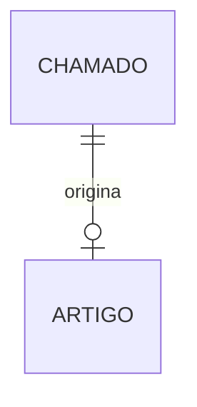

# Artigo a partir da resposta de um chamado

## Problem

Quando o assistente não acha fonte, a conversa vira chamado e a equipe responde. Essa resposta resolve o caso de uma aluna e depois some: a próxima aluna com a mesma dúvida cai de novo em "sem base", abre outro chamado e recebe a mesma resposta escrita à mão. Hoje o atendente só tem `RespostaPronta` do setor, que serve para ele colar, e o artigo só nasce pela tela do administrador, do zero, sem nenhuma ligação com o chamado que mostrou a lacuna. Quem paga é a aluna, que espera por uma resposta que a instituição já deu, e a equipe, que a repete.

Evidência: a devolutiva da banca (17/11/2026) pergunta "se uma resposta padrão é gerada pela IA, por que a mesma resposta não é gerada no chat?". Não há medida de repetição, porque não há produção. A prática de gestão de conhecimento de helpdesk (KCS) captura o artigo como subproduto da resolução do caso ([Consortium for Service Innovation](https://library.serviceinnovation.org/KCS/KCS_v6/KCS_v6_Practices_Guide/020), conteúdo parafraseado).

Depois disto, o atendente que resolveu um chamado aciona "Criar artigo a partir desta resposta", revisa o texto e salva um rascunho ligado ao chamado. O administrador ativa o rascunho e, só então, o assistente passa a responder a mesma pergunta no chat.

## Flow

Reusa `ValidacaoDeArtigo` e `Artigo.Criar` (mesmas regras do artigo criado pelo administrador), o acesso por setor de `AcessoChamado` e a validade de 1 ano de `validade-do-conhecimento`.

1. tela do chamado resolvido (exists) - o atendente aciona o botão; o formulário abre preenchido no navegador com a última resposta pública da equipe, que ele já lê no detalhe
2. `POST /api/chamados/{numero}/artigo` (new, `Chamados/Acoes`, door 1) - confere o acesso ao chamado, valida com `ValidacaoDeArtigo`, recusa CPF no texto, cria o artigo `RASCUNHO` com a categoria do chamado e grava a origem
3. `Artigo` (exists) - guarda `origem_chamado_id` (door 1); a lista `Artigos` mostra "Origem: ESC-NNNNNN"
4. `AtivarArtigo` (exists) - o administrador revisa e ativa; só então `BuscarFontes` passa a incluir o texto

## Impact

| Front | What changes |
| --- | --- |
| domain | novo termo: `origem do artigo` - o chamado que motivou o rascunho; vive em `Artigo`, só leitura depois de criado |
| domain | termo existente: "fonte publicada" não muda; rascunho continua fora do assistente (`ArtigosBuscaveis` exige `ATIVO`) |
| API | `GET /api/artigos` ganha `origemChamado` (protocolo ou nulo), aditivo; o resto do contrato e o MCP ficam como estão (AD-055) |
| stored data | `artigo` ganha uma coluna anulável; os artigos existentes ficam com nulo, nada a migrar |
| privacy | o rascunho nasce de texto que a equipe escreveu para uma pessoa; título e perguntas nunca vêm do texto da aluna, e CPF no texto é recusado (AC 6) |
| tests | os retratos da API ganham `origemChamado` na lista de artigos; nenhuma asserção existente muda |

## Relations

One-way constraints: um chamado origina no máximo um artigo (door 1). O artigo não depende do chamado para existir; se o chamado for removido a origem só deixa de ser exibida. Sem colunas e sem tipos aqui além dos que são porta.

## Surface

| Route | In | Out | Status |
| --- | --- | --- | --- |
| `POST /api/chamados/{numero}/artigo` | `titulo`, `perguntas`, `resposta`, `links` | o artigo `RASCUNHO` criado, com `origemChamado` | `201`, `400`, `401`, `403`, `404`, `409` |

## Landing

| One-way door | Literal shape | Alternative rejected |
| --- | --- | --- |
| 1. origem do artigo | `origem_chamado_id` anulável em `artigo`, com índice único parcial `WHERE origem_chamado_id IS NOT NULL`; segunda chamada para o mesmo chamado responde `409` "Este chamado já originou o artigo X." | sem ligação, só o texto copiado: duas pessoas clicando criam dois rascunhos iguais e o administrador não sabe de onde veio; uma tabela de ligação `chamado_artigo` muitos para muitos: ninguém pediu mais de um artigo por chamado e a tabela custaria um join em toda lista |

- Nada mais nesta mudança é difícil de desfazer. O texto do botão, o pré-preenchimento e a faixa de aviso mudam por refatoração.

## Criteria

### S1: O atendente transforma a resposta em rascunho (P1)

**Acceptance Criteria**

1. WHEN um atendente do setor do chamado, ou o responsável, chama `POST /api/chamados/{numero}/artigo` com `titulo`, `perguntas`, `resposta` e `links` válidos sobre um chamado `RESOLVIDO` ou `FECHADO` THEN the system SHALL responder `201` com um artigo `RASCUNHO`, categoria igual à categoria atual do chamado, `origemChamado` igual ao protocolo e `validoAte` igual a hoje mais 12 meses
2. The system SHALL aplicar as mesmas regras de `ValidacaoDeArtigo` do artigo criado pelo administrador, e IF alguma falhar THEN responder `400` com ProblemDetails do campo
3. IF o chamado está `ABERTO`, `EM_ATENDIMENTO` ou `AGUARDANDO_ALUNO` THEN the system SHALL responder `409` com "O chamado ainda não foi resolvido."
4. IF o chamado já originou um artigo THEN the system SHALL responder `409` e não criar outro, também com duas chamadas simultâneas
5. IF o chamado não existe, é de outra instituição ou o usuário não vê esse chamado THEN the system SHALL responder `404`, e `403` ao `ADMINISTRADOR` em `LEITURA` e ao aluno, e `401` sem sessão
6. IF `titulo`, `perguntas` ou `resposta` contêm um CPF válido, formatado ou não, THEN the system SHALL responder `400` e não criar o artigo
7. WHEN o rascunho é criado THEN the system SHALL registrar um log informativo com o id da instituição e o protocolo, sem o texto

### S2: A tela leva o atendente até o rascunho e o administrador até a ativação (P1)

**Acceptance Criteria**

8. WHEN o atendente abre um chamado `RESOLVIDO` ou `FECHADO` que ainda não originou artigo THEN the system SHALL mostrar o botão "Criar artigo a partir desta resposta"
9. WHEN o atendente aciona o botão THEN the system SHALL abrir o formulário com a resposta preenchida pela última mensagem pública da equipe, o título e as perguntas vazios, e a faixa "Remova nomes, CPF e matrícula antes de salvar"
10. WHEN o atendente salva THEN the system SHALL criar o rascunho, mostrar "Rascunho criado. O administrador precisa ativar antes de o assistente usar." e trocar o botão por "Artigo criado: ESC-NNNNNN"
11. IF o chamado já originou artigo THEN the system SHALL não mostrar o botão, e mostrar o aviso do AC 10
12. WHEN o administrador abre `Artigos` THEN the system SHALL mostrar "Origem: ESC-NNNNNN" nos artigos que vieram de chamado, e o filtro de estado existente mostra os rascunhos
13. IF a criação falha THEN the system SHALL manter o formulário aberto com o texto digitado e mostrar a mensagem do ProblemDetails
14. WHILE a criação está em andamento the system SHALL desabilitar o botão de salvar

## Out of scope

| Excluded | Why |
| --- | --- |
| a IA escrever o rascunho sozinha a partir do chamado | o texto vem de uma conversa com dado pessoal; a revisão humana é o filtro de privacidade, e gerar com IA é produto novo |
| ativar o artigo automaticamente | o assistente só responde com fonte revisada e publicada pelo administrador |
| sugerir artigo a cada chamado resolvido ou medir repetição de pedidos | o pedido é fechar o ciclo; sugestão proativa e métrica de repetição ficam para quando houver dados de uso |
| vincular um chamado a um artigo que já existe | é outra capacidade: "este artigo resolveria"; fica para depois |
| anonimizar nomes por reconhecimento automático | só o CPF é detectável sem falso positivo; nomes e matrícula dependem do atendente, e a faixa avisa |

## Assumptions

| Assumption | Chosen default | Rationale | Confirmed? |
| --- | --- | --- | --- |
| quem pode criar | atendente do setor do chamado ou responsável; o administrador cria pela tela `Artigos` | quem resolveu conhece a resposta; o administrador já tem a tela própria | y - owner approved the plan (17/11) |
| de qual mensagem sai o texto | a última mensagem pública da equipe antes de `RESOLVIDO` | é a que o aluno recebeu como solução | y - owner approved the plan (17/11) |
| categoria do rascunho | a categoria atual do chamado, não a original | reclassificação corrige o roteamento e o artigo deve ficar na categoria certa | y - owner approved the plan (17/11) |
| quando o botão aparece | só em `RESOLVIDO` e `FECHADO` | antes disso a resposta ainda pode mudar | y - owner approved the plan (17/11) |
| aviso ao administrador de rascunho novo | nenhum; ele vê o filtro de rascunhos e a etiqueta de origem | e-mail por rascunho é ruído; a validade já avisa sobre o que vence | y - owner approved the plan (17/11) |

**Open questions:** none - all resolved or logged above.

## Observable

| Surface | Decision | Landing |
| --- | --- | --- |
| screen detalhe do chamado (equipe) | empty, loading, error state | AC 13; empty e loading existing - a tela já trata |
| screen detalhe do chamado (equipe) | unauthorised state | AC 5; o botão não aparece a quem não é da equipe do chamado |
| screen detalhe do chamado (equipe) | density and ordering | AC 8: o botão entra na barra de ações do chamado resolvido |
| screen detalhe do chamado (equipe) | destructive action confirms | n/a - criar rascunho não publica nem apaga nada (AC 10) |
| screen detalhe do chamado (equipe) celular 360×780 | layout | AC 9: o formulário ocupa a largura da tela e a faixa de aviso fica acima dos campos |
| screen detalhe do chamado (equipe) celular deitado 844×390 | layout | AC 9: o formulário rola na vertical e o botão salvar fica no fim, visível ao rolar |
| screen detalhe do chamado (equipe) teclado aberto | layout | AC 9: o campo em foco continua visível acima do teclado e o botão salvar acessível ao rolar |
| screen detalhe do chamado (equipe) toque | alvos | AC 8, AC 10: botão e salvar com 44 px de altura no celular |
| screen `Artigos` | empty, loading, error, unauthorised | existing - sem mudança; AC 12 só acrescenta a etiqueta |
| screen `Artigos` | density and ordering | AC 12: a etiqueta entra na linha existente |
| API `POST /api/chamados/{numero}/artigo` | error shape and codes | AC 2, AC 3, AC 4, AC 5, AC 6 (ProblemDetails por `Problemas.Erro` e `Problemas.Invalido`) |
| API `POST /api/chamados/{numero}/artigo` | who may call | AC 5 |
| API `POST /api/chamados/{numero}/artigo` | versioning, rate limits | n/a - a API não versiona rotas e a criação de artigo pelo administrador não tem limite de taxa hoje |

### As nove dimensões (resumo; o registro com checks vai em `checks.md` `## Swept`)

| Dimension | Landing |
| --- | --- |
| Validation and bounds | AC 2, AC 6 |
| Failure and partial failure | AC 13; a criação é um único `SaveChanges` |
| Idempotency, retry, duplicates | AC 4, door 1 (índice único parcial) |
| Authorization and rate limits | AC 5; rate limit n/a (ver Observable) |
| Concurrency and ordering | AC 4 (duas chamadas simultâneas) |
| Data lifecycle | n/a - o artigo não depende do chamado depois de criado, e a validade de 1 ano vem de `validade-do-conhecimento` (AC 1) |
| External-dependency failure | n/a - nenhuma dependência externa; a indexação do rascunho só acontece na ativação |
| State transitions | AC 3 (só `RESOLVIDO` e `FECHADO`), AC 1 (nasce `RASCUNHO`) |
| Observability | AC 7 |

## Sources

- Pedido do dono, 17/11/2026 - "siga com o que for recomendado" sobre a pergunta "por que a resposta padrão não é gerada no chat"; devolutiva da banca, item 12
- `.specs/STATE.md` AD-008 (instituição em toda tabela), AD-055 (saída do MCP)
- [KCS v6, Practices Guide](https://library.serviceinnovation.org/KCS/KCS_v6/KCS_v6_Practices_Guide/020) (conteúdo parafraseado)
