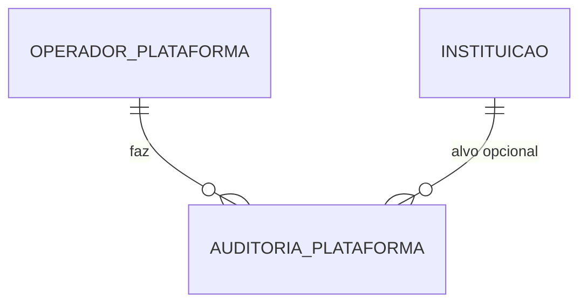

# Console da plataforma: o acesso master fora das instituições

## Problem

O acesso de quem opera o Esclari hoje é um usuário de uma instituição com o papel `OPERADOR` (AD-033). Esse papel só nasce por um comando no servidor (`instituicao operador --slug --cpf`), a pessoa entra pelo CPF dentro de uma instituição qualquer (`/{slug}`) e vê o grupo "Plataforma" no menu daquela instituição. Quem paga é a equipe do Esclari, e o produto tem três defeitos:

- o operador é registro de uma instituição: aparece na lista de usuários dela, entra no filtro de `instituicao_id` dela e some se ela for desativada;
- o painel só lista nome, situação e número de administradores. Não diz se a instituição está usando o produto, se o assistente está respondendo, se os e-mails saem ou se a base de conhecimento venceu. O problema de um cliente só aparece quando o cliente reclama;
- ninguém registra quem criou, alterou, desativou ou reenviou o acesso de uma instituição (não há tabela de auditoria no código).

Evidência: o código (`Esclari.Api/Instituicoes/Plataforma/`, `ComandoOperador.cs`, `Papeis.Operador`) e o pedido do dono em 18/11/2026: o acesso master "tem que única e exclusivamente gerenciar e criar", fora de qualquer instituição, com o painel dando ao dev o que ele precisa para operar. O roadmap diz que a taxa de "não encontrei" é o maior risco técnico e que os testes não a medem. A fonte não traz mais números.

Depois desta feature, a equipe do Esclari entra em `/plataforma` com e-mail, senha e código de aplicativo autenticador, numa conta que não pertence a nenhuma instituição. A lista mostra, por instituição, os sinais de saúde (última atividade, taxa de "não encontrei" dos últimos 30 dias, fila de chamados, e-mails falhando, conteúdo vencido) e põe no topo quem precisa de atenção. Dali o operador cria, ajusta, importa a carga, reenvia o acesso e desativa uma instituição, e tudo o que fez fica registrado. A área não mostra chamado, mensagem nem usuário de dentro de nenhuma instituição. O servidor só é tocado para criar, desativar ou redefinir o segundo fator de um operador.

## Flow

Reusa os casos de uso de instituição que já existem (`CriarInstituicao`, `ComandoCarga`, `ListarInstituicoes`, `DesativarInstituicao`, `ReativarInstituicao`, `ReenviarAcesso`), o `PasswordHasher`, o limitador `auth`, a fila `EmailSaida` para o e-mail do administrador da instituição, e o SQL de agregação sem filtro de instituição que `ListarInstituicoes` já usa.

1. navegador em `/plataforma` -> `web/src/plataforma/` (new, door 5) - telas de entrada, código, lista, detalhe e auditoria
2. `POST /api/plataforma/auth/entrar` -> `Plataforma/Acesso` (new, door 5) - confere e-mail e senha em `operador_plataforma` (door 1), grava o cookie de etapa de 5 minutos
3. `POST /api/plataforma/auth/codigo` -> `Totp` (new, door 3) - confere o código e abre a sessão do esquema `Plataforma` (door 2)
4. toda rota `/api/plataforma/*` -> esquema `Plataforma` (door 2) - sem sessão da plataforma, 401
5. `Plataforma/Instituicoes` (new, door 5) - os casos de uso de instituição de `Instituicoes/Plataforma` (exist) mudam de pasta e de esquema; `EditarInstituicao` e `VerInstituicao` (new, no door - placement per conventions) alteram nome e fuso e mostram o detalhe
6. `Plataforma/Instituicoes` - `ListarInstituicoes` (exists) passa a devolver `saude`, calculada por SQL de agregação sobre `conversa`, `mensagem_conversa`, `chamado`, `usuario`, `email_saida`, `artigo` e `documento`
7. `Plataforma/Auditoria` (new, door 4) - cada caso de uso de escrita grava uma linha em `auditoria_plataforma` na mesma transação
8. comando `plataforma operador` (new, no door - placement) - cria, convida de novo, desativa, reativa e redefine o segundo fator de um operador, sem passar pela API
9. out: JSON da rota, cookie de sessão, e-mail do administrador da instituição (pela fila de e-mail da própria instituição) e a linha de auditoria

## Impact

| Front | What changes |
| --- | --- |
| domain | novo termo: `operador da plataforma` - conta de quem opera o Esclari; e-mail, nome, senha e segundo fator; não pertence a instituição; vive em `Plataforma/` |
| domain | termo existente: `OPERADOR` era um papel de `usuario_papel` dentro de uma instituição (AD-033); deixa de existir como papel. Quem ramifica nele hoje: `InstituicoesExtensoes` (filtro 403), `ComandoOperador`, `Papeis.Operador`, o grupo "Plataforma" de `web/src/Menu`, `PlataformaTests` e os e2e `instituicoes*.spec.ts` |
| domain | termo existente: "toda tabela tem `instituicao_id` não nulo e query filter global" (AD-008) ganha uma exceção de duas tabelas, as da plataforma (door 1) |
| domain | novo termo: `slug` reservado `plataforma`, porque `/plataforma` e `/{slug}` dividem o primeiro segmento da URL |
| domain | novo termo: `saúde` - conjunto de contagens e uma data por instituição, calculado na leitura, nunca gravado |
| API | as rotas de `/api/plataforma/instituicoes` mantêm corpo e statuses, mas a autorização passa de papel `OPERADOR` (403) para sessão da plataforma (401); `desativar` passa a exigir `motivo`; a lista ganha `saude` e `situacao` |
| API | nenhuma rota fora de `/api/plataforma` muda; o MCP não muda |
| stored data | duas tabelas novas e uma limpeza: `DELETE FROM usuario_papel WHERE papel = 'OPERADOR'` (operadores que já existem, como o do seed de apresentação, perdem o papel e precisam ser criados de novo pelo comando; nada de instituição é tocado) |
| CLI | sai `instituicao operador`; entra `plataforma operador`; `instituicao criar`, `carga` e `avaliar-busca` ficam |
| tests | `PlataformaTests` e `instituicoes*.spec.ts` trocam a forma de entrar (operador da plataforma em vez de papel), numa lista explícita em `checks.md` que o Verifier confere; `ArquiteturaTests` ganha as exceções da door 1 e a fatia `Plataforma` da door 5 |
| docs | AD novo no `STATE.md` que supersede o AD-033 e emenda o AD-008 e o AD-017; `AGENTS.md` (lista de fatias) e `GLOSSARIO.md` |

## Relations

One-way constraints: `operador_plataforma` não tem `instituicao_id` e tem e-mail único sem diferenciar maiúsculas (door 1); `auditoria_plataforma` não tem `instituicao_id`, tem `instituicao_alvo_id` anulável e `operador_id` não nulo, as duas chaves em restrição de exclusão, e nunca é alterada nem apagada (door 4). Sem colunas e sem tipos além dos das doors.

## Surface

Todas sob `/api/plataforma`, esquema `Plataforma`, salvo as de entrada.

| Route | In | Out | Status |
| --- | --- | --- | --- |
| `POST /auth/entrar` | `email`, `senha` | `etapa` (`CODIGO` ou `CADASTRAR`), e em `CADASTRAR` também `segredo` e `uri` | `200`, `400`, `401`, `429` |
| `POST /auth/codigo` | `codigo` | vazio, cookie de sessão | `204`, `400`, `401`, `429` |
| `POST /auth/definir-senha` | `token`, `senha` | vazio | `204`, `400`, `429` |
| `POST /auth/sair` | vazio | vazio | `204` |
| `GET /eu` | vazio | `id`, `nome`, `email` | `200`, `401` |
| `GET /instituicoes` | vazio | lista de `slug`, `nome`, `fuso`, `ativa`, `situacao`, `criadaEm`, `administradores`, `saude`, `atencao` | `200`, `401` |
| `GET /instituicoes/{slug}` | vazio | os campos da lista e `administradoresDaInstituicao` (`nome`, `emailMascarado`, `primeiroAcessoPendente`) | `200`, `401`, `404` |
| `PUT /instituicoes/{slug}` | `nome`, `fuso` | os campos da lista | `200`, `400`, `401`, `404` |
| `POST /instituicoes` (já existe) | como hoje | como hoje | `201`, `400`, `401`, `409` |
| `POST /instituicoes/{slug}/desativar` (já existe) | `motivo` | como hoje | `200`, `400`, `401`, `404` |
| `POST /instituicoes/{slug}/reativar`, `/reenviar-acesso`, `/carga` (já existem) | como hoje | como hoje | os de hoje, com `401` no lugar de `403` |
| `GET /auditoria` | `instituicao` (slug, opcional), `pagina` | `itens` (`acao`, `operador`, `instituicao`, `resumo`, `criadaEm`), `total` | `200`, `400`, `401` |

`saude` (contrato lido só pela própria tela): `ultimaAtividadeEm`, `chamadosAbertos`, `chamadoMaisAntigoAbertoDias`, `conversas30Dias`, `semBaseTaxa30Dias`, `respostas30Dias`, `alunosAtivos`, `equipeAtiva`, `emailsComFalha`, `conteudoVencido`. `situacao`: `ATIVA`, `AGUARDANDO_PRIMEIRO_ACESSO` ou `DESATIVADA`. `atencao`: lista dos motivos em código (`PARADA`, `MUITOS_SEM_BASE`, `EMAILS_FALHANDO`, `CONTEUDO_VENCIDO`, `FILA_ANTIGA`).

## Landing

| One-way door | Literal shape | Alternative rejected |
| --- | --- | --- |
| 1. onde moram os operadores | tabela `operador_plataforma` sem `instituicao_id`; índice `CREATE UNIQUE INDEX ux_operador_plataforma_email ON operador_plataforma (lower(email))`; `ArquiteturaTests` lista as duas tabelas da plataforma (`operador_plataforma`, `auditoria_plataforma`) como as únicas sem `instituicao_id` | uma instituição reservada `plataforma` com os operadores dentro (mantém o AD-008 intacto): ela apareceria na lista de instituições, entraria nos filtros, nos indicadores e nos e-mails com o nome dela, e o operador continuaria sendo "usuário de uma instituição", que é o que o dono recusou |
| 2. sessão própria | esquema de cookie `Plataforma`, cookie `esclari_plataforma`, `Path=/api/plataforma`, `HttpOnly`, `SameSite=Strict`, `Secure` quando a requisição é `https`, 30 minutos sem uso e 8 horas no máximo; cookie de etapa `esclari_plataforma_etapa` de 5 minutos, protegido pelo Data Protection com propósito próprio | reaproveitar o cookie das instituições com uma claim `plataforma`: o mesmo cookie valeria nos dois mundos, a sessão de uma instituição ficaria a uma claim do poder total, e `CookieDeSessao.Validar` assume linhas de `usuario` e `instituicao` que o operador não tem |
| 3. segundo fator | TOTP RFC 6238 em código do projeto: HMAC-SHA1, 6 dígitos, passo de 30 s, janela de um passo para cada lado, segredo de 20 bytes aleatórios em base32, guardado protegido pelo Data Protection (propósito `plataforma.totp`) em `operador_plataforma.totp_segredo`, e `totp_ultimo_passo` impede reutilizar o código; obrigatório no primeiro acesso | pacote NuGet de TOTP: dependência nova no componente que guarda o acesso a todas as instituições, e o algoritmo cabe em 40 linhas provadas pelos vetores do próprio RFC 6238; código por e-mail ou SMS: prende a segurança à caixa de entrada e ao SMTP, que ainda não está definido (pergunta 4), e a documentação da Microsoft prefere o aplicativo ao SMS; sem segundo fator: é a única conta que alcança todas as instituições |
| 4. registro de auditoria | tabela `auditoria_plataforma` (`acao`, `operador_id`, `instituicao_alvo_id` anulável, `resumo` de até 200 caracteres, `criada_em timestamptz`), só inclusão: sem rota nem método que altere ou apague; `acao` é uma destas oito: `OPERADOR_ENTROU`, `INSTITUICAO_CRIADA`, `INSTITUICAO_ALTERADA`, `INSTITUICAO_DESATIVADA`, `INSTITUICAO_REATIVADA`, `ACESSO_REENVIADO`, `CARGA_IMPORTADA`, `OPERADOR_ALTERADO` (esta última grava o que o comando fez, com o e-mail do operador só no `resumo` do próprio operador alvo, sem senha nem token); o `resumo` nunca leva CPF, senha nem token | `jsonb` com os detalhes: formato livre deixaria um emissor gravar dado pessoal sem o compilador avisar; arquivo de log: não se consulta pela tela e some a cada implantação; `evento_chamado`: pertence a um chamado de uma instituição |
| 5. fatia nova | `Esclari.Api/Plataforma/` com as subpastas `Acesso`, `Instituicoes` e `Auditoria`, namespace `Esclari.Api.Plataforma.<Subpasta>`, e `web/src/plataforma/`; o que hoje está em `Esclari.Api/Instituicoes/Plataforma/` muda para `Plataforma/Instituicoes`; a lista de fatias e de subpastas do `ArquiteturaTests` e do AD-017 e AD-056 ganham `Plataforma` | manter tudo em `Instituicoes/Plataforma` (já são 10 arquivos, o limite é 12 por subpasta e a lista de subpastas é fechada): mistura o código do mundo da plataforma com o das instituições e a regra de arquitetura que as mantém separadas deixa de ser testável |
| 6. endereço | `/plataforma` na raiz do `web/`, e o slug `plataforma` recusado em `Criacao.Validar` (`400` no campo `slug`) | subdomínio `plataforma.esclari.com.br`: depende de DNS e de hospedagem que ainda não estão definidos (pergunta 5) |
| 7. fim do papel | `Papeis.Operador` sai do vocabulário e uma migration roda `DELETE FROM usuario_papel WHERE papel = 'OPERADOR'` | deixar o valor dormindo: manteria vivos o filtro 403, o comando e o grupo do menu, e um operador antigo continuaria "valendo" numa instituição sem segundo fator |

- Nada mais nesta mudança é difícil de desfazer. Nomes de telas, textos, limites de página, o limiar de 14 dias e a faixa de 1 em cada 3 mudam por refatoração.
- A porta 1 fecha uma coisa: nenhuma tabela de dados de instituição pode ficar sem `instituicao_id`. A exceção vale só para as duas tabelas da plataforma, que não guardam dado de aluno.
- A lista de ações da porta 4 é fechada, e a feature seguinte (`parametros-por-instituicao`) acrescenta uma ação: a porta cresce por linha, nunca é reescrita.

## Criteria

### S1: A conta da plataforma e a entrada (P1)

Alguém da equipe do Esclari entra em `/plataforma` sem ser usuário de instituição nenhuma.

**Acceptance Criteria**

1. The system SHALL guardar cada operador da plataforma em conta própria, com e-mail, nome, senha e segundo fator, sem `instituicao_id`, de modo que nenhum operador aparece em `GET /api/usuarios` de nenhuma instituição
2. WHEN `dotnet Esclari.Api.dll plataforma operador --email <e-mail> --nome <nome>` roda e não há operador com esse e-mail THEN the system SHALL criar o operador sem senha, gravar `OPERADOR_ALTERADO` na auditoria e imprimir o link de criação de senha, válido por 60 minutos
3. IF o operador existe e ainda não definiu a senha THEN the system SHALL gerar um convite novo, invalidar o anterior e imprimir o link; IF já definiu a senha THEN the system SHALL sair com código diferente de zero e a frase "Esse operador já existe."
4. WHEN o comando recebe `--desativar`, `--reativar` ou `--redefinir-2fa` para um operador que existe THEN the system SHALL aplicar a mudança, gravar `OPERADOR_ALTERADO` e imprimir uma frase de confirmação; IF o operador não existe THEN the system SHALL sair com código diferente de zero; IF a mudança é `--desativar` do último operador ativo THEN the system SHALL recusar com código diferente de zero
5. WHEN `POST /api/plataforma/auth/definir-senha` recebe o token do convite e uma senha de 8 a 128 caracteres THEN the system SHALL gravar a senha, invalidar o token e responder `204`
6. IF o token do convite é inválido, venceu ou já foi usado, ou a senha tem menos de 8 ou mais de 128 caracteres THEN the system SHALL responder `400` com ProblemDetails
7. WHEN `POST /api/plataforma/auth/entrar` recebe e-mail e senha corretos de um operador ativo que já tem segundo fator THEN the system SHALL responder `200` com `etapa` igual a `CODIGO`, gravar o cookie de etapa de 5 minutos e não abrir a sessão
8. WHEN o mesmo `POST` vem de um operador ativo sem segundo fator THEN the system SHALL responder `200` com `etapa` igual a `CADASTRAR`, `segredo` em base32 e `uri` no formato `otpauth://totp/Esclari:<e-mail>?secret=<segredo>&issuer=Esclari`, e gravar o cookie de etapa
9. IF o e-mail não existe, a senha está errada ou o operador está desativado THEN the system SHALL responder `401` com a frase "E-mail ou senha inválidos.", sem diferenciar os três casos
10. WHEN `POST /api/plataforma/auth/codigo` recebe um código TOTP de 6 dígitos válido para o passo atual, o anterior ou o seguinte, e o cookie de etapa vale THEN the system SHALL abrir a sessão `Plataforma`, apagar o cookie de etapa, gravar `totp_ultimo_passo`, gravar `OPERADOR_ENTROU` e responder `204`; na etapa `CADASTRAR` o mesmo acerto também grava o segredo
11. IF o código está errado, repete um passo já usado, ou o cookie de etapa falta ou venceu THEN the system SHALL responder `401` e não abrir a sessão
12. IF o formato do corpo é inválido (código que não tem 6 dígitos, e-mail vazio) THEN the system SHALL responder `400`
13. WHILE o limite do limitador `auth` está estourado para o endereço, the system SHALL responder `429` em `entrar`, `codigo` e `definir-senha`
14. WHILE a sessão da plataforma ficou 30 minutos sem requisição, ou passaram 8 horas desde a entrada, the system SHALL responder `401` em toda rota `/api/plataforma/*`
15. WHEN `POST /api/plataforma/auth/sair` é chamado THEN the system SHALL apagar os dois cookies e responder `204`
16. WHEN `GET /api/plataforma/eu` é chamado com sessão válida THEN the system SHALL responder `200` com `id`, `nome` e `email`, sem hash nem segredo
17. IF uma rota `/api/plataforma/*` (fora as de entrada) recebe só o cookie de uma instituição, de qualquer papel, THEN the system SHALL responder `401`
18. IF uma rota `/api/*` fora de `/api/plataforma` recebe o cookie da plataforma THEN the system SHALL responder `401`
19. IF o operador é desativado enquanto tem sessão aberta THEN the system SHALL responder `401` já na requisição seguinte dele

### S2: Saúde de cada instituição (P1)

Quem opera vê, sem abrir nada por dentro, onde há problema, e a lista põe esses casos no topo.

**Acceptance Criteria**

20. WHEN `GET /api/plataforma/instituicoes` é chamado THEN the system SHALL devolver em cada item `saude` com `ultimaAtividadeEm`, `chamadosAbertos`, `chamadoMaisAntigoAbertoDias`, `conversas30Dias`, `respostas30Dias`, `semBaseTaxa30Dias`, `alunosAtivos`, `equipeAtiva`, `emailsComFalha` e `conteudoVencido`
21. The system SHALL definir `ultimaAtividadeEm` como o `criado_em` mais recente entre as conversas e os chamados da instituição, ou `null` quando não há nenhum; `chamadosAbertos` como os chamados fora dos estados finais; `chamadoMaisAntigoAbertoDias` como os dias inteiros desde o mais antigo deles, ou `null`; `conversas30Dias` como as conversas criadas nos últimos 30 dias
22. The system SHALL definir `respostas30Dias` como as mensagens do assistente dos últimos 30 dias e `semBaseTaxa30Dias` como a fração delas com `tipo_final` igual a `sem_base`, ou `null` quando `respostas30Dias` é zero
23. The system SHALL definir `emailsComFalha` como os `email_saida` sem envio que esgotaram as tentativas, `conteudoVencido` como os artigos e documentos ativos com `valido_ate` no passado, `alunosAtivos` como os usuários ativos com o papel `ALUNO` e `equipeAtiva` como os ativos com `ATENDENTE` ou `ADMINISTRADOR`
24. The system SHALL calcular `saude` só com contagens, uma fração e uma data, em SQL de agregação, sem devolver texto, nome, CPF ou e-mail de chamado, mensagem ou usuário
25. WHEN uma instituição ativa tem `ultimaAtividadeEm` de 14 dias atrás ou mais, ou `null` há mais de 14 dias da criação, THEN the system SHALL incluir `PARADA` em `atencao`
26. WHEN `semBaseTaxa30Dias` passa de um terço com `respostas30Dias` de 20 ou mais THEN the system SHALL incluir `MUITOS_SEM_BASE` em `atencao`; WHEN `emailsComFalha` é maior que zero THEN `EMAILS_FALHANDO`; WHEN `conteudoVencido` é maior que zero THEN `CONTEUDO_VENCIDO`; WHEN `chamadoMaisAntigoAbertoDias` passa de `ResolucaoHoras` dividido por 24 THEN `FILA_ANTIGA`
27. WHERE a lista tem mais de uma instituição, the system SHALL ordenar as ativas com `atencao` antes das sem `atencao`, e as desativadas por último, dentro de cada grupo por nome
28. WHEN a instituição tem administradores ativos e nenhum deles definiu senha THEN the system SHALL devolver `situacao` igual a `AGUARDANDO_PRIMEIRO_ACESSO`; WHEN está desativada THEN `DESATIVADA`; nos demais casos `ATIVA`

### S3: Ciclo de vida da instituição pelo painel (P1)

Criar, ajustar, importar a carga, reenviar o acesso e desativar sem terminal.

**Acceptance Criteria**

29. WHEN o operador chama as rotas de instituição que já existem (listar, criar, importar carga, desativar, reativar, reenviar acesso) THEN the system SHALL manter o corpo e os statuses de hoje, trocando a autorização do papel `OPERADOR` pela sessão da plataforma, de modo que o `403` de quem não é operador vira `401`
30. IF o `slug` de uma instituição nova é `plataforma` THEN the system SHALL responder `400` com o erro no campo `slug`
31. WHEN `POST /api/plataforma/instituicoes/{slug}/desativar` recebe `motivo` de 3 a 200 caracteres THEN the system SHALL desativar como hoje e gravar o motivo no `resumo` da auditoria; IF o `motivo` falta ou fica fora desse tamanho THEN the system SHALL responder `400`
32. WHEN `GET /api/plataforma/instituicoes/{slug}` é chamado THEN the system SHALL responder `200` com os campos da lista e `administradoresDaInstituicao` com `nome`, `emailMascarado` (primeira letra, `***`, e o domínio) e `primeiroAcessoPendente`; IF o slug não existe THEN the system SHALL responder `404`
33. WHEN `PUT /api/plataforma/instituicoes/{slug}` recebe `nome` de 3 a 120 caracteres e um `fuso` que o sistema operacional reconhece THEN the system SHALL alterar só o nome e o fuso, deixar o `slug` como está e responder `200`
34. IF o `nome` ou o `fuso` do `PUT` é inválido THEN the system SHALL responder `400` com o campo; IF o corpo traz `slug` THEN the system SHALL ignorá-lo sem erro
35. WHEN o operador termina de criar uma instituição na tela THEN the system SHALL oferecer, na mesma tela, importar a carga JSON e mostrar as contagens do resultado, sem pedir outro caminho

### S4: Registro do que a equipe fez (P1)

**Acceptance Criteria**

36. WHEN ocorre uma das oito ações da door 4 THEN the system SHALL gravar uma linha em `auditoria_plataforma` na mesma transação da ação, com o operador, a ação, a instituição alvo quando há, e um `resumo`
37. IF a ação falha e a transação volta THEN the system SHALL não deixar linha de auditoria dela
38. The system SHALL não aceitar nenhuma rota nem método que altere ou apague uma linha de `auditoria_plataforma`
39. The system SHALL escrever o `resumo` sem CPF, senha nem token, e com no máximo 200 caracteres
40. WHEN `GET /api/plataforma/auditoria` é chamado, com `instituicao` opcional e `pagina` a partir de 1, THEN the system SHALL responder `200` com 50 itens por página, do mais novo ao mais antigo, e o `total`
41. IF `pagina` é menor que 1 ou `instituicao` não é um slug conhecido THEN the system SHALL responder `400`

### S5: O fim do papel `OPERADOR` nas instituições (P1)

**Acceptance Criteria**

42. WHEN a migration roda THEN the system SHALL apagar de `usuario_papel` as linhas com `papel` igual a `OPERADOR` e não tocar em nenhuma outra linha
43. IF um administrador de instituição tenta dar o papel `OPERADOR` a um usuário THEN the system SHALL responder `400` como para qualquer papel desconhecido
44. The system SHALL não aceitar mais `instituicao operador` na linha de comando, imprimindo o uso com os comandos que restam
45. WHILE um usuário de instituição está logado, the system SHALL não mostrar o grupo "Plataforma" no menu

### S6: As telas de `/plataforma` (P1)

**Acceptance Criteria**

46. WHEN o operador abre `/plataforma` sem sessão THEN the system SHALL mostrar o formulário de e-mail e senha; WHEN a resposta é `CODIGO` THEN the system SHALL pedir os 6 dígitos; WHEN é `CADASTRAR` THEN the system SHALL mostrar a chave em grupos de 4, um link "Abrir no aplicativo" para a `uri` e o campo do código
47. WHEN a sessão é válida THEN the system SHALL mostrar uma casca própria, com a marca do Esclari e nunca a de uma instituição, e os itens "Instituições" e "Auditoria"
48. WHEN a lista de instituições abre THEN the system SHALL mostrar por linha o nome, a situação, a data da última atividade, a taxa de "não encontrei" em porcentagem e as etiquetas de `atencao` em português ("Parada", "Muitos 'não encontrei'", "E-mails falhando", "Conteúdo vencido", "Fila antiga")
49. WHEN uma lista (instituições, auditoria) vem vazia THEN the system SHALL mostrar a frase de estado vazio da tela e, em instituições, o botão "Nova instituição"
50. IF uma chamada à API volta `401` com a sessão aberta THEN the system SHALL levar o operador a `/plataforma` com a frase "Sua sessão terminou. Entre de novo."
51. WHEN o operador desativa uma instituição THEN the system SHALL pedir confirmação com o nome da instituição e o campo do motivo

## Out of scope

| Excluded | Why |
| --- | --- |
| Parâmetros por instituição (metas de prazo, validade, lembretes) | feature seguinte, `parametros-por-instituicao`, com plano próprio; mexe em tudo que lê `Prazos` |
| Carga assistida (simular e modelo), criar administradores e atendentes da instituição, lista de prontidão | feature seguinte, `implantacao-de-instituicao`, que escreve na instituição alvo e por isso tem plano e regra de arquitetura próprios |
| Marca padrão do Esclari nas instituições | feature `marca-padrao-esclari`, independente deste console |
| Convidar e desativar operadores pela tela | o comando basta enquanto a equipe é de poucas pessoas; a tela entra quando houver mais |
| Motivo de cada resposta "não encontrei" (busca fora do ar, provedor fora do ar, número sem fonte) | hoje só vai para o log, não para o banco; mostrar exige coluna nova em `mensagem_conversa` |
| Uso de tokens e custo da IA por instituição | o produto calcula o uso em `Assistente.cs` e só o registra no log |
| Entrar como suporte numa instituição (ver como o usuário vê) | o dono pediu que o acesso master só gerencie e crie; a pesquisa pede, se um dia houver, só leitura, 30 minutos, consentimento do cliente e identidade dupla no registro |
| Ver chamados, mensagens ou usuários de uma instituição | fora da finalidade; a `saude` é só contagem |
| Planos, cobrança e limites por instituição | não existe modelo comercial no produto |
| Apagar instituição, editar o `slug` | nada se apaga (exigência do MEC), e o slug está em todos os links já enviados |
| QR code do segundo fator | exigiria biblioteca nova; a chave em texto e o link `otpauth://` bastam |
| Códigos de recuperação, login por SSO, vários dispositivos | quem perde o aplicativo é resolvido pelo comando `--redefinir-2fa` |
| Aviso à instituição de que a equipe mexeu nela, e mostrar a auditoria ao administrador dela | nenhuma instituição pediu |

## Assumptions

| Assumption | Chosen default | Rationale | Confirmed? |
| --- | --- | --- | --- |
| O acesso master não é uma instituição e só gerencia | conta separada, sem acesso ao interior das instituições | pedido do dono em 18/11 | y |
| O painel serve para o dev operar: saúde primeiro, depois ciclo de vida, parâmetros na feature seguinte | a ordem das fatias segue essa prioridade | pedido do dono em 18/11 ("o intuito é mais parametrizações") e a ordem que ele aprovou | y |
| Operadores nascem e saem por comando | o comando é o único uso do servidor | a equipe é de uma ou duas pessoas; a tela de operadores fica para depois | n |
| Entrada | e-mail e senha, com segundo fator por aplicativo autenticador obrigatório | uma conta que alcança todas as instituições; a documentação da Microsoft prefere TOTP a SMS | n |
| Tempos de sessão | 30 minutos sem uso e 8 horas no máximo; cookie de etapa de 5 minutos; convite de 60 minutos | mesmos 60 minutos do primeiro acesso; os 30 minutos seguem a prática de sessão curta para poder alto | n |
| Senha do operador | 8 a 128 caracteres, como a do restante do produto | consistência com `Senha.cs` | n |
| O que é "não encontrei" | resposta do assistente com `tipo_final` igual a `sem_base`, contada por mensagem e não por conversa | é o dado que já existe; a faixa de um terço vem do próprio roadmap | n |
| Limiares de atenção | 14 dias sem atividade; um terço de "não encontrei" com 20 respostas ou mais; fila mais antiga acima da meta de resolução em dias | números simples para a primeira versão; mudam por refatoração | n |
| Fila antiga usa a meta global | `ResolucaoHoras / 24` | até `parametros-por-instituicao` existir, a meta é uma só | n |
| Operadores que já existem | perdem o papel na migration e são recriados pelo comando | mantê-los seria manter o caminho antigo | n |

**Open questions:**

| # | Kind | Question | Until answered |
| --- | --- | --- | --- |
| 1 | blocks go-live | qual SMTP envia o e-mail do administrador de cada instituição nova (pergunta 4 do roadmap) | o Mailpit local recebe tudo, e o link de primeiro acesso aparece na resposta do comando `instituicao criar` |
| 2 | blocks go-live | em que endereço público o painel fica (pergunta 5), porque `Secure` e `https` dependem dele | em ambiente local o cookie vale sem `Secure` |
| 3 | open | quais são os e-mails dos operadores iniciais | o comando cria o primeiro com o e-mail que você informar |

## Observable

| Surface | Decision | Landing |
| --- | --- | --- |
| screen `/plataforma` (entrada) | empty state | n/a - a tela é o formulário |
| screen `/plataforma` (entrada) | loading state | AC 46 (botão desabilitado enquanto envia) |
| screen `/plataforma` (entrada) | error state | AC 9, AC 11, AC 13 |
| screen `/plataforma` (entrada) | unauthorised | AC 50 |
| screen "Instituições" | empty state | AC 49 |
| screen "Instituições" | density and ordering | AC 27, AC 48 |
| screen "Instituições" | error state | AC 50 |
| screen "Instituições" | destructive action confirms | AC 51 |
| screen "Instituições" | unauthorised | AC 17, AC 50 |
| screen "Detalhe da instituição" | empty and error state | AC 32 (404), AC 49 |
| screen "Auditoria" | empty state, ordering | AC 40, AC 49 |
| screen "Auditoria" | error state | AC 41, AC 50 |
| API all `/api/plataforma/*` | error shape and codes | existing - ProblemDetails de `Problemas.cs`, status por critério |
| API all `/api/plataforma/*` | who may call | AC 17, AC 18 |
| API `POST /api/plataforma/auth/*` | rate limit | AC 13 |
| API all new routes | versioning | n/a - o produto não versiona rotas |
| command `plataforma operador` | output, flags, exit codes | AC 2, AC 3, AC 4 |
| command `plataforma operador` | failure halfway | AC 4 (nada é gravado se a validação falha) |
| celular 360×780 | tabelas viram lista de cartões, botões de 44 px, sem rolagem lateral | AC 47, AC 48 |
| celular deitado 844×390 | n/a - a casca usa a barra lateral recolhível da casca atual e a lista rola dentro da página | n/a - sem layout dependente da altura |
| teclado aberto | os campos de código e senha continuam visíveis acima do teclado | AC 46 |
| toque | alvos de 44 px ou mais | AC 47 |

## Sources

- `.specs/STATE.md` AD-008 (tenancy), AD-017 e AD-056 (fatias e subpastas), AD-033 (papel `OPERADOR`, que este plano supersede), AD-060 (indicadores) - o que a mudança emenda ou substitui
- `.specs/features/instituicoes-plataforma/plan.md` e `ROADMAP.md` (a taxa de "não encontrei" como maior risco técnico, a faixa de 1 em cada 3, e "Segunda instituição: tela do operador") - o que existe e o que ficou fora em 04/11
- Pedido do dono, 18/11/2026: o acesso master só gerencia e cria, fora das instituições, e o painel serve ao dev para operar e parametrizar
- [AWS Well-Architected SaaS Lens: tenant insights](https://docs.aws.amazon.com/wellarchitected/latest/saas-lens/tenant-insights.html) - atividade e consumo por locatário como base da visão de saúde
- [Pigment: impersonação segura](https://engineering.pigment.com/2026/04/08/safe-user-impersonation/) - sessão limitada a 30 minutos e registro completo; base dos tempos de sessão e do que fica fora do escopo
- [WorkOS: sessões delegadas e registro com identidade dupla](https://workos.com/blog/support-impersonation-delegated-sessions) e [AppMaster: personificação com consentimento e auditoria](https://appmaster.io/blog/secure-admin-impersonation-controls-audit-scope) - o registro deve nomear quem agiu
- [NHIMG: governança entre locatários](https://nhimg.org/faq/how-should-msps-govern-access-across-multiple-saas-tenants/) e [itechguides: isolar primeiro, depois autorizar](https://www.itechguides.com/multi-tenant-saas-permissions-separate-isolation-from-access/) - cada instituição é uma fronteira; ação entre fronteiras é explícita e registrada
- [Booknetic: área do dono da plataforma separada da do cliente](https://www.booknetic.com/documentation/data-isolation-and-permissions) - área própria do dono para gerir locatários
- [WebCheatSheet: encerrar um locatário](https://webcheatsheet.com/saas/saas-tenant-offboarding-revoke-access-retention) - bloquear atividade nova e revogar credenciais antes de qualquer retenção; é o que a desativação com motivo faz
- [Microsoft Learn: TOTP no ASP.NET Core](https://learn.microsoft.com/en-us/aspnet/core/security/authentication/identity-enable-qrcodes?view=aspnetcore-10.0) - aplicativo autenticador preferido ao SMS; RFC 6238 como base do algoritmo
