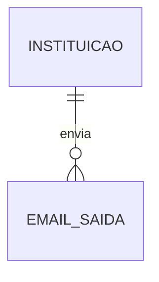

# E-mails com a cara da instituição

## Problem

Hoje todo e-mail do Esclari sai com o mesmo molde: uma faixa colorida com o nome da instituição e um único parágrafo de texto corrido (`LayoutEmail.Html`). Quem paga é o aluno, que recebe um aviso de "nova resposta", "foi resolvida" ou "crie sua senha" sem título, sem botão e com o endereço do chamado escrito por extenso no meio do texto, e a equipe, que recebe o resumo de atrasos e de validade como uma lista de traços e URLs soltas. Evidência no código: o molde não tem botão, rodapé, idioma, `<title>` nem tratamento de tema escuro; o padrão de cor é `#C83A23`, o vermelho anterior à marca (AD-063 fixou a Tinta `#0e1330` como cor de ação sem cor de instituição); o e-mail sai identificado só pelo nome da instituição, e a faixa de cor sob um logo escuro pode deixá-lo ilegível. Não há dado de abertura ou de clique no produto.

Depois disto, cada e-mail abre com a identidade da instituição (logo ou nome, filete na cor dela), um título que diz o que aconteceu, o texto curto, um botão grande com a ação seguinte, o endereço por extenso logo abaixo para quem não vê o botão, e um rodapé que diz quem enviou e que o aviso é automático. O texto puro (a parte `text/plain`) continua igual.

## Flow

Reusa a fila `EmailSaida`, a tarefa `EnviarEmails`, o `EnviadorSmtp` (logo inline por `cid:logo`, `multipart/alternative`) e o `LayoutEmail.Html` já existentes; muda o molde e o que a fila guarda, não o caminho.

1. emissor (`Avisos`, `AvisarAtrasos`, `AvisarValidade`, `PrimeiroAcesso`, `Criacao.EmailDeAcesso`, todos exist) - monta assunto, corpo em texto e agora `titulo`, `acao_rotulo`, `acao_url`; grava `EmailSaida` (exists, door 1) na mesma transação de sempre
2. `EnviarEmails` (exists) - lê a linha e chama `EnviadorSmtp.Enviar` com os três campos novos
3. `EnviadorSmtp` (exists) - baixa o logo, monta `text/plain` com o corpo de sempre e `text/html` pelo `LayoutEmail`
4. `LayoutEmail` (exists, door 2) - renderiza o molde de coluna única; sem `titulo` e sem ação (linha antiga na fila) renderiza o mesmo molde sem título e sem botão
5. out: a mensagem SMTP; o Mailpit local mostra o resultado

## Impact

| Front | What changes |
| --- | --- |
| domain | novo termo: `ação do e-mail` - rótulo e endereço do único botão do e-mail; vive em `EmailSaida` |
| domain | termo existente: `corpo` do `EmailSaida` continua sendo o texto puro completo (é a parte `text/plain` e a fonte do HTML); quem ramifica nele hoje: `EnviadorSmtp`, `LayoutEmail` e os testes de e-mail |
| domain | termo existente: cor padrão do e-mail `#C83A23` (vermelho antigo) passa a ser a Tinta `#0e1330`, igual ao botão da interface sem cor de instituição (AD-063); a cor da instituição segue valendo quando existe |
| API | nenhuma rota muda de assinatura ou de JSON; o assunto de todos os e-mails fica como está (`[Instituição] ...`) |
| stored data | `email_saida` ganha três colunas anuláveis (door 1); linhas já na fila ou já enviadas ficam com `NULL` e saem com o molde novo, sem título e sem botão; nada a migrar |
| tests | as asserções de `EmailMarcaTests` que gravam o molde antigo (`background-color:#8a1538` no cabeçalho, `background-color:#C83A23`, `color:#ffffff` do padrão) mudam por consequência direta, numa lista explícita que o Verifier confere; as demais (texto igual ao corpo, escape, `cid:logo`, MinIO fora, `multipart/alternative`) ficam como estão |
| tests | `ArquiteturaTests` não muda: `LayoutEmail` e `EnviadorSmtp` já estão na lista da raiz, e o tipo novo vive em `Dados/Emails/` |
| docs | `.specs/GLOSSARIO.md` ganha `ação do e-mail` |

## Relations

Constraint one-way: `email_saida` ganha `titulo`, `acao_rotulo` e `acao_url`, os três anuláveis e preenchidos juntos ou nenhum no caso da ação (door 1). Sem colunas além dessas e sem tipos aqui.

## Surface

None - nothing consumed outside. O contrato novo é o da própria fila, em Landing.

## Landing

| One-way door | Literal shape | Alternative rejected |
| --- | --- | --- |
| 1. o que a fila guarda | `email_saida`: `titulo text NULL`, `acao_rotulo text NULL`, `acao_url text NULL`; `EmailSaida.Criar(destinatario, assunto, corpo, agora, titulo: null, acao: null)` com `acao` um par `(rotulo, url)`; `titulo` e `acao` nulos = e-mail simples, como as linhas antigas | descobrir o botão lendo o corpo (primeira URL vira botão com rótulo fixo): o resumo de atrasos tem dezenas de URLs e a heurística erraria em silêncio; `jsonb` com o modelo inteiro: sem tipo, e o próximo emissor poderia gravar um formato que o molde não conhece, sem o compilador avisar |
| 2. como o HTML é produzido | `LayoutEmail.Html(...)` continua uma função em C# que monta o texto do documento, sem pacote novo; coluna única em `<table role="presentation">`, largura 100% e máximo 600 px, estilos em linha, um bloco `<style>` só para `@media (prefers-color-scheme: dark)` e `@media (max-width:480px)` | MJML: pede Node na cadeia de build do .NET e gera um arquivo que ninguém edita; Razor ou Scriban com arquivos de modelo: dependência nova para oito mensagens, e o corpo escapado hoje é testado num lugar só |

- A escolha de coluna única, 600 px e botão em tabela vem da pesquisa em Sources; trocá-la depois é refatoração do `LayoutEmail`, não uma porta
- Nada mais nesta mudança é difícil de desfazer. Textos de título e de botão, cores do tema escuro e tamanhos mudam por refatoração.

## Criteria

### S1: O molde novo (P1)

Todo e-mail sai num molde de coluna única que a pessoa lê no celular e no computador, claro ou escuro.

**Acceptance Criteria**

1. The system SHALL emitir o HTML de todo e-mail com `<html lang="pt-BR">`, `<title>` igual ao assunto, `<meta name="viewport" content="width=device-width, initial-scale=1">` e `<meta name="color-scheme" content="light dark">`
2. The system SHALL montar o corpo do HTML em tabelas de layout com `role="presentation"`, largura 100% e máximo 600 px, numa única coluna, e nenhum `<script>`, `<form>` nem recurso remoto além do `cid:logo`
3. The system SHALL escrever o texto do e-mail com 16 px ou mais, entrelinha 1,5, fonte `Arial, Helvetica, sans-serif` e a cor Tinta `#0e1330` sobre fundo branco (contraste 17,7 para 1)
4. WHEN a instituição tem logo THEN the system SHALL mostrar `">` com altura máxima de 40 px no cabeçalho branco, sob um filete de 4 px na cor da instituição
5. WHEN a instituição não tem logo, ou o armazenamento do logo está fora, THEN the system SHALL mostrar o nome da instituição em texto de 20 px, em negrito, no mesmo cabeçalho e sem `cid:`
6. WHERE a instituição não define cor, the system SHALL usar a Tinta `#0e1330` no filete e no botão
7. The system SHALL inserir antes do título um texto de pré-visualização oculto (`display:none`) com o primeiro parágrafo do corpo cortado em 90 caracteres
8. WHEN o leitor está em tema escuro THEN the system SHALL trocar, por `@media (prefers-color-scheme: dark)`, o fundo para `#0e0e18`, o cartão para `#151620`, o texto para `#f0eee9` e o texto secundário para `#a0a1a8`, mantendo o cabeçalho com o logo sobre fundo branco e a cor do botão
9. The system SHALL escrever o rodapé com "Enviado pelo Esclari para <nome da instituição>." e "Este aviso é automático; não responda este e-mail.", em 14 px, na cor `#5c5d64` sobre o fundo claro (contraste 6,0 para 1)
10. WHILE a largura é de 480 px ou menos, the system SHALL reduzir o preenchimento lateral do cartão de 32 para 20 px e manter o botão com 100% da largura
11. The system SHALL manter a parte `text/plain` idêntica ao corpo gravado na fila, sem título, botão ou rodapé
12. IF o corpo traz `<`, `>`, `&` ou aspas THEN the system SHALL escapá-los no HTML, como hoje, e nunca emitir `<script>` vindo do corpo, do título, do rótulo ou do nome da instituição
13. The system SHALL gerar, para um e-mail com 50 itens de lista, um HTML de no máximo 100 KB, porque o Gmail corta a mensagem a partir de 102 KB

### S2: Título, botão e lista (P1)

O e-mail diz o que aconteceu, dá um botão para a próxima ação e mostra a lista de forma legível.

**Acceptance Criteria**

14. WHERE a linha tem `titulo`, the system SHALL mostrá-lo como `<h1>` de 24 px em negrito, antes do texto
15. WHERE a linha tem `acao_rotulo` e `acao_url`, the system SHALL mostrar um botão `<a href="<acao_url>">` com altura mínima de 44 px, texto branco de 16 px em negrito, cantos de 6 px, fundo na cor da instituição (ou Tinta), e uma versão para Outlook em VML dentro de comentário condicional `<!--[if mso]>`
16. WHERE há botão, the system SHALL escrever logo abaixo "Se o botão não abrir, copie este endereço:" seguido do endereço por extenso como link, e omitir do HTML a linha do corpo que repete só esse endereço
17. IF `acao_url` não começa com `Tokens.UrlBase` THEN the system SHALL omitir o botão e o endereço, sem erro, e mandar o e-mail
18. The system SHALL mostrar como lista (`<ul>`) cada bloco de linhas do corpo que começam com "- ", e como parágrafo (`
`) cada bloco separado por linha em branco; uma linha só com um endereço `http` ou `https` vira link, e qualquer outro texto continua texto
19. WHEN `Avisos.Resolvido` envia a mensagem THEN the system SHALL mostrar o texto da resolução num bloco de citação com filete à esquerda
20. WHEN um e-mail é enviado por `Avisos.NovaResposta` THEN the system SHALL usar o título "Sua solicitação recebeu uma resposta" e o botão "Ver a resposta"
21. WHEN um e-mail é enviado por `Avisos.Resolvido` THEN the system SHALL usar o título "Sua solicitação foi resolvida" e o botão "Confirmar ou rejeitar"
22. WHEN um e-mail é enviado por `Avisos.AguardaResposta` THEN the system SHALL usar o título "A equipe aguarda a sua resposta" e o botão "Responder"
23. WHEN `AvisarAtrasos` envia o resumo THEN the system SHALL usar o título "Chamados em atraso" (ao setor) ou "Resumo de chamados em atraso" (ao administrador) e o botão "Ver chamados em atraso"
24. WHEN `AvisarValidade` envia o aviso THEN the system SHALL usar o título "Conteúdo para renovar" e o botão "Abrir a lista"
25. WHEN o primeiro acesso ou a criação da instituição envia o link de senha THEN the system SHALL usar o título "Crie a sua senha", o botão "Criar senha" e, no texto, a validade do link e "Se você não pediu isso, ignore este e-mail."

### S3: Fila que já existe (P1)

Nada que já está na fila quebra.

**Acceptance Criteria**

26. WHEN a fila tem uma linha anterior à mudança (`titulo`, `acao_rotulo` e `acao_url` nulos) THEN the system SHALL enviá-la no molde novo, sem título e sem botão, e marcá-la como enviada
27. The system SHALL manter o assunto de todos os e-mails como está hoje (`[<instituição>] ...`)

## Out of scope

| Excluded | Why |
| --- | --- |
| Editar o molde, as cores ou os textos do e-mail pela tela de Aparência | nenhuma instituição pediu; a cor e o logo que ela já define bastam |
| Rastreio de abertura e de clique | LGPD (AD-031 trata o que sai para fora) e nenhum critério depende disso |
| Cancelar inscrição (unsubscribe) | todos os e-mails são transacionais: o aluno não se inscreve neles |
| Novos e-mails ou novos gatilhos | só muda a aparência dos sete que existem |
| Trocar os assuntos | os testes e os clientes de e-mail agrupam por eles hoje |
| Fonte da marca no e-mail (Public Sans) | fonte web não carrega na maioria dos clientes; a pilha segura é a que vale |
| Marca Esclari no cabeçalho | a identidade da instituição prevalece no produto dela (AD-032); o Esclari aparece só no rodapé |

## Assumptions

| Assumption | Chosen default | Rationale | Confirmed? |
| --- | --- | --- | --- |
| Onde fica a cor da instituição | filete de 4 px no topo e botão; o cabeçalho é branco | o logo enviado pela instituição pode ser escuro ou ter fundo transparente, e o tema escuro de Gmail e Outlook inverte fundos coloridos (pesquisa); a cor da instituição já passa de 4,5 para 1 contra o branco (AD-032), então o texto do botão é legível | n |
| Tema escuro | só onde o cliente respeita `prefers-color-scheme` (Apple Mail, iOS); nos demais o cliente decide, e o molde fica legível porque usa cores neutras e o logo vive em cartão branco | Gmail ignora o CSS do remetente e aplica a própria inversão; não há como controlar | n |
| Fonte | `Arial, Helvetica, sans-serif` | fonte web não carrega em Gmail e Outlook | n |
| Largura | 600 px | padrão de fato dos clientes e da pesquisa | n |
| Valores de cor | os tokens de `web/src/index.css` convertidos para hexadecimal (fundo `#f7f5ee`, borda `#dddbd2`, texto secundário `#5c5d64`, escuro `#0e0e18`/`#151620`/`#f0eee9`/`#a0a1a8`), e a Tinta `#0e1330` do guia de marca | e-mail não lê `oklch` nem variável CSS; a conversão é mecânica | n |
| Texto de pré-visualização | primeiro parágrafo do corpo, cortado em 90 caracteres | evita um campo novo na fila | n |

**Open questions:** none - all resolved or logged above.

## Observable

| Surface | Decision | Landing |
| --- | --- | --- |
| e-mail (HTML) | estado vazio: corpo sem parágrafo, sem título e sem ação | AC 26 (linha antiga) |
| e-mail (HTML) | estado de erro: logo indisponível, endereço da ação inválido | AC 5, AC 17 |
| e-mail (HTML) | estado de carregamento | n/a - o e-mail é estático |
| e-mail (HTML) | quem pode ver | n/a - o e-mail vai só ao destinatário, e o link da ação já exige login |
| e-mail (HTML) | densidade e ordem: título, texto, botão, endereço, rodapé | AC 14 a AC 16, AC 9 |
| e-mail (HTML) | ação destrutiva confirmada antes | n/a - o botão só abre uma página; confirmar ou rejeitar acontece dentro do app |
| e-mail (HTML) | acessibilidade: idioma, tabelas de layout, texto alternativo, contraste | AC 1, AC 2, AC 4, AC 3, AC 9 |
| e-mail (HTML) | tema escuro | AC 8 |
| e-mail (HTML) | cliente sem imagem | AC 5 (nome em texto), AC 16 (endereço por extenso) |
| e-mail (HTML) | voz e tom: frases curtas em português, o que aconteceu e o que fazer | AC 20 a AC 25 |
| documento `text/plain` | estrutura | AC 11 |
| celular 360×780 | coluna única e botão em largura total | AC 2, AC 10 |
| celular deitado 844×390 | n/a - o molde é de 600 px e não depende da altura | n/a - sem layout por altura |
| teclado aberto | n/a - o e-mail não tem campo de texto | n/a - sem campo |
| toque | alvo do botão com 44 px ou mais de altura | AC 15 |
| Mailpit local (`GET /api/v1/message/{id}/html-check`) | compatibilidade de HTML e CSS entre clientes | AC 2, AC 13 (prova no checks) |

## Sources

- `.specs/features/marca-esclari/guia-de-marca.md` e AD-032, AD-034, AD-063 a AD-065 - Tinta `#0e1330`, identidade da instituição prevalece, fonte do produto, cor de ação sem cor de instituição
- `web/src/index.css` - tokens de cor claro e escuro convertidos para o e-mail
- [Tabular: como desenhar e-mails transacionais](https://tabular.email/blog/how-to-design-transactional-emails) - coluna única de 600 px, logo no topo, uma só ação dominante, botão de 44 px ou mais, validade do link e "se não foi você" nos e-mails de conta, rodapé discreto
- [Guia de acessibilidade de e-mail (accessibility.build)](https://accessibility.build/guides/accessible-email) e [NSW Email Design System](https://email.designsystem.nsw.gov.au/development/accessibility-for-email-developers) - `role="presentation"` nas tabelas, `lang` declarado, texto alternativo, ordem do código igual à ordem de leitura
- [Resend: boas práticas de e-mail transacional](https://github.com/resend/resend-skills/blob/main/skills/email-best-practices/references/transactional-emails.md) - parágrafos curtos, uma ação por e-mail
- [HTML Email Design Best Practices 2026 (Warmy)](https://www.warmy.io/blog/email-best-practices/html-email-design-best-practices/) - tabela de coluna única, estilos em linha, texto em HTML e não em imagem, corpo de 16 px ou mais, `alt` útil
- [Courier: modo escuro em e-mail](https://www.courier.com/blog/dark-mode-email-design) e [Postdrop](https://blog.postdrop.io/post/dark-mode-email-design/) - Apple Mail respeita `color-scheme` e `prefers-color-scheme`; Gmail aplica a própria transformação; por isso cores neutras e logo em cartão branco
- [Mailpit: HTML check](https://mailpit.axllent.org/docs/usage/html-check/) - nota de compatibilidade do HTML contra a base caniemail, usada como prova
- [Postmark: modelos de e-mail transacional](https://postmarkapp.com/transactional-email-templates) - estrutura de referência (cabeçalho, título, corpo, botão, rodapé) para recuperação de senha e avisos
