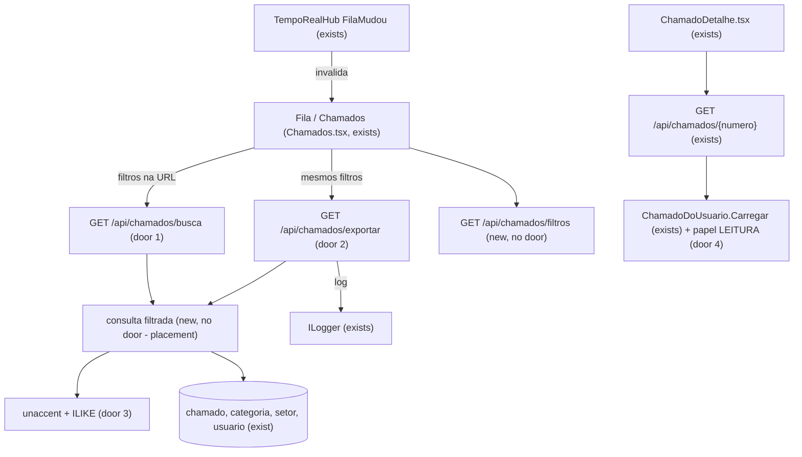

# Filtros na lista de chamados e relatório em CSV

## Problem

Quem atende não consegue achar um chamado nem recortar a fila. A tela Fila (`web/src/chamados/Chamados.tsx`) lista todos os chamados dos setores do atendente, do mais antigo para o mais novo, sem busca e sem filtro. A rota `GET /api/chamados?escopo=fila` aceita um `estado`, mas a tela não usa (`Esclari.Api/Chamados/Consulta/ListarChamados.cs`).

- Um chamado `FECHADO` some de toda lista (`c.Estado != Fechado` na fila). Para reabrir a conversa com um aluno que voltou a perguntar, o atendente precisa saber o número de cor e digitar a URL.
- Não há como ver só "os meus", só "os sem responsável", só uma categoria ou só os abertos numa semana. O atendente rola a lista inteira, 50 por vez.
- O administrador que não é atendente não vê chamado nenhum: não tem lista e `ChamadoDoUsuario.Carregar` responde 404 ao detalhe. O RF-03 diz que o administrador vê todos os chamados (`D:\One\One\docs\requisitos\conteudo.md`, RF-03).
- Nada sai do sistema. Os Indicadores mostram totais e taxas do período, mas não a lista de chamados por trás deles, e não existe exportação em lugar nenhum do produto (nenhum `text/csv` no código). A coordenadora relatou que o MEC exige registro das manifestações e que elas gerem insumos para melhoria (conteúdo.md, linha 115); a "exportação de relatórios" ficou fora do escopo inicial (conteúdo.md, linha 30).
- Quem paga: o atendente, que perde tempo procurando, e o gestor, que monta relatório à mão. Evidência: nenhuma medida de uso (não há produção); o problema vem da leitura do código e do pedido do dono em 17/11.

Depois disto, o atendente busca por número, título ou nome do aluno, filtra por estado (inclusive Fechado), setor, categoria, responsável e período de abertura, e o recorte fica na URL. O administrador tem a tela Chamados com todos os setores e lê qualquer chamado sem poder agir nele. Qualquer recorte sai num CSV que abre certo no Excel em português, sem dado pessoal do aluno.

## Flow

Reusa a fila e o detalhe que já existem: o filtro de instituição global (AD-008), a regra de escopo por setor e a recusa de liderança de `LeitorIndicadores`, o `ChamadoDoUsuario.Carregar` e o `PermissoesChamado` para o detalhe, o `Periodo` (DayPicker), o `Sheet`, o `native-select`, o `useMostrarMais` como forma do "Mostrar mais 50", o aviso `FilaMudou` do SignalR e as políticas de `Seguranca.cs` para o limite.

1. A tela lê os filtros da query string e chama `GET /api/chamados/busca` com `escopo=fila` (Fila) ou `escopo=todos` (Chamados, administrador).
2. A consulta resolve o escopo (setores do atendente ou todos), aplica estado, setor, categoria, responsável, período e busca, conta o total e devolve a página de 50.
3. `GET /api/chamados/exportar` usa a mesma consulta sem página, até 10 000 linhas, e devolve o CSV; registra uma linha de log.
4. `GET /api/chamados/filtros` (new, no door - placement) devolve os setores do escopo e as categorias da instituição para os campos do painel.
5. O detalhe de um chamado aberto por um administrador fora dos setores dele sai com o papel `LEITURA`: tudo o que a equipe vê, nenhuma ação.
6. `FilaMudou` do `TempoRealHub` (exists) invalida todas as consultas de busca abertas; a tela refaz a busca com os mesmos filtros.

## Impact

| Front | What changes |
| --- | --- |
| domain | termo novo: `busca` - lista filtrada e paginada de chamados; vive em `Chamados/Consulta` |
| domain | termo novo: papel de chamado `LEITURA` - administrador que lê sem agir; ao lado de `ALUNO`, `ATENDENTE`, `LIDER` em `PermissoesChamado`. Quem ramifica no papel hoje: `DetalheChamado.Montar` (`equipe`, `lider`), `PermissoesChamado.Acoes/Estados`, `AgirNoChamado`, `TempoRealHub.EntrarNoChamado`, `BaixarAnexo` |
| domain | termo existente: "Fila" continua sendo os setores do atendente sem `FECHADO` por padrão; com o filtro de estado passa a mostrar `FECHADO` também |
| rota existente | `GET /api/chamados?escopo=fila\|meus` não muda; o `listar_chamados` do MCP continua lendo `ListarChamados.RespostaDaFila` com o mesmo JSON (AD-055, `McpFerramentasTests`) |
| rota existente | `GET /api/chamados/{numero}` para um administrador fora do setor passa de `404` a `200` com `acoes: []`; as ações `POST` continuam `403` para ele. Hoje nenhum teste espera esse `404` de administrador (a conferir no build; se houver, é emenda, não edição) |
| web | `Fila` passa a chamar `/api/chamados/busca`; `UrlDaFila` sai de `tempo-real.ts` e as duas invalidações usam a chave `ChaveDaBusca` (`['busca']`). Os testes que simulavam `GET /api/chamados?escopo=fila` (16 arquivos Vitest e 5 e2e, mais `e2e/simulada.ts`) passam a simular a busca com o envelope `{ itens, total, pagina, porPagina }` pelos auxiliares `FILA`, `rotasDaFila`, `comoPagina` e `rotaDaLista` de `web/src/test/util.tsx`; `web/src/test/estrutura.test.ts` passa a ignorar a query string ao ler a rota aberta por `abrir(...)` |
| web | `Autenticado.tsx`: com o item `chamados` no menu, a rota `chamados/:numero` continua aberta a todo papel (`podeAbrir`) e "no chamado" passa a exigir o número na URL, para a lista `/:slug/chamados` não esconder a barra de baixo |
| web | menu: item novo "Chamados" (`/:slug/chamados`) para `ADMINISTRADOR` no grupo Atendimento. A barra inferior do celular do administrador passa de Indicadores, Gerir, Conta a Chamados, Indicadores, Gerir, Conta (AD-052 aceita de 3 a 5); testes do `mobile-m1-casca` que fixam essa barra mudam por emenda |
| stored data | nada a migrar: só leitura de `chamado`, `mensagem_chamado`, `categoria`, `setor`, `usuario` e `matricula`. A migration cria a extensão `unaccent`, sem tocar em linha. A busca por texto é varredura sequencial dentro da instituição (`unaccent` não é `IMMUTABLE` e não entra em índice); aceita para o volume de uma instituição |

## Relations

`None - no stored-data shape change` (a extensão `unaccent` é uma dependência do banco, registrada na porta 3; nenhuma tabela ou coluna nova).

## Surface

| Route | In | Out | Status |
| --- | --- | --- | --- |
| `GET /api/chamados/busca` | `escopo` (`fila` ou `todos`), `q`, `estado` (repetível), `setorId`, `categoriaId`, `responsavel` (`eu` ou `ninguem`), `de`, `ate`, `ordem` (`antigos` ou `recentes`), `pagina` | `itens` · `total` · `pagina` · `porPagina` | `200`, `400`, `401`, `403` |
| `GET /api/chamados/exportar` | os mesmos de `busca`, sem `pagina` | arquivo `text/csv` | `200`, `400`, `401`, `403`, `429` |
| `GET /api/chamados/filtros` | `escopo` (`fila` ou `todos`) | `setores` · `categorias` | `200`, `401`, `403` |
| `GET /api/chamados/{numero}` (existe) | - | mesmo corpo; para `LEITURA`, `acoes` vazio | `200` para administrador fora do setor (era `404`) |

Telas:

1. `/:slug/fila` (existe, atendente): barra com o campo de busca, o botão "Filtros" e o botão "Exportar CSV"; abaixo, as etiquetas dos filtros ativos com "Limpar filtros" e a contagem "N chamados"; depois a tabela atual.
2. `/:slug/chamados` (nova, administrador): a mesma tela com escopo `todos`, a coluna "Setor" e o título "Chamados".
3. Painel "Filtros": `Sheet` à direita a partir de 768 px e de baixo abaixo disso; campos Estado (caixas de marcação), Setor, Categoria, Responsável, Período de abertura e Ordem; rodapé com "Limpar" e "Aplicar".

## Landing

| One-way door | Literal shape | Alternative rejected |
| --- | --- | --- |
| 1. contrato da busca | `GET /api/chamados/busca?escopo=fila&q=boleto&estado=ABERTO&estado=FECHADO&setorId=2&categoriaId=5&responsavel=eu&de=2026-11-01&ate=2026-11-30&ordem=recentes&pagina=2` -> `{ "itens": [{ "numero": "ESC-000123", "titulo": "Boleto não chegou", "estado": "FECHADO", "setor": "Financeiro", "categoria": "Boleto", "responsavel": "Ana Souza"\|null, "criadoEm": "2026-11-03T13:00:00Z", "dias": 15 }], "total": 73, "pagina": 2, "porPagina": 50 }`; sem `estado`, os quatro estados não fechados; `porPagina` fixo em 50; `dias` é o mesmo cálculo da fila atual | acrescentar os filtros e o envelope `{itens,total}` a `GET /api/chamados?escopo=fila`: a resposta deixa de ser lista e quebra o `listar_chamados` do MCP, cuja saída o AD-055 fixa; paginação por cursor (keyset) rejeitada porque a ordem muda com `ordem` e a fila tem poucos milhares de linhas por instituição |
| 2. formato do CSV | `GET /api/chamados/exportar?<filtros>` -> `Content-Type: text/csv; charset=utf-8`, `Content-Disposition: attachment; filename="chamados-<slug>-<AAAA-MM-DD>.csv"`; corpo com BOM UTF-8, separador `;`, fim de linha CRLF, cabeçalho `Número;Título;Estado;Setor;Categoria;Categoria original;Responsável;Curso;Semestre;Aberto em;Primeira resposta em;Resolvido em;Fechado em;Motivo de fechamento;Reaberturas;Encaminhamentos`; datas `dd/MM/aaaa HH:mm` no fuso da instituição; estado e motivo com o rótulo em português; célula com `;`, `"`, CR ou LF entre aspas com `"` dobrada (RFC 4180); célula que começa com `=`, `+`, `-`, `@`, TAB ou CR ganha `'` na frente (OWASP) | vírgula como separador: o Excel em pt-BR usa `;` como separador de lista e abre a vírgula numa coluna só; sem BOM o Excel lê UTF-8 como CP-1252 e estraga os acentos; XLSX ou PDF: exige biblioteca nova, e o CSV já abre no Excel, no LibreOffice e no Google Planilhas |
| 3. extensão `unaccent` | `mb.HasPostgresExtension("unaccent")` em `EsclariDb` e uma migration `BuscaDeChamados` só com `CREATE EXTENSION IF NOT EXISTS unaccent`; filtro `EF.Functions.ILike(EF.Functions.Unaccent(c.Titulo), EF.Functions.Unaccent("%" + q + "%"), "\\")` com `%`, `_` e `\` do texto escapados | só `ILIKE`: "matricula" não acha "Matrícula", e o aluno escreve das duas formas; busca textual (`tsvector`): não acha parte de número ("123" em `ESC-000123`) e pede coluna e índice novos |
| 4. papel `LEITURA` | `PermissoesChamado.Leitura = "LEITURA"`; `ChamadoDoUsuario.Carregar` devolve `(c, "LEITURA")` quando o usuário tem `ADMINISTRADOR` e nenhum dos casos anteriores vale; `Permitidas` não ganha linha para `LEITURA`, então `Acoes` é vazio e `AgirNoChamado` responde `403`; no detalhe `LEITURA` vê o mesmo que `ATENDENTE` (notas, fontes, setores) | dar ao administrador as ações de atendente em todo chamado: ele passaria a responder em nome de setores que não são dele, e o RF-03 pede ver, não agir; um endpoint de detalhe só para administrador: duplicaria `DetalheChamado.Montar` |

- Nada mais nesta mudança é difícil de desfazer. Nomes dos campos do painel, textos, a coluna "Setor" e o limite de 10 000 mudam por refatoração.

## Criteria

### S1: Busca e filtros na API (P1)

O atendente recebe só os chamados que pediu, dentro dos setores dele.

**Acceptance Criteria**

1. WHEN um `ATENDENTE` chama `GET /api/chamados/busca?escopo=fila` sem outro filtro THEN o sistema SHALL devolver os chamados dos setores dele nos estados `ABERTO`, `EM_ATENDIMENTO`, `AGUARDANDO_ALUNO` e `RESOLVIDO`, do mais antigo para o mais novo, os mesmos números que `GET /api/chamados?escopo=fila` devolve
2. WHEN `estado` vem uma ou mais vezes THEN o sistema SHALL devolver só os chamados nesses estados, e `FECHADO` SHALL aparecer quando pedido
3. WHEN `q` vem preenchido THEN o sistema SHALL devolver os chamados cujo número, título ou nome do solicitante contém `q` sem diferença de maiúscula e de acento ("matricula" acha "Matrícula", "123" acha `ESC-000123`)
4. IF `q` contém `%` ou `_` THEN o sistema SHALL tratá-los como caracteres comuns (`q=%` não devolve todos os chamados)
5. WHEN `categoriaId` vem THEN o sistema SHALL devolver só os chamados com essa categoria atual
6. WHEN `setorId` vem THEN o sistema SHALL devolver só os chamados desse setor
7. IF `escopo=fila` e `setorId` não é de um setor do atendente THEN o sistema SHALL responder `403` com "Este setor não é seu."
8. WHEN `responsavel=eu` THEN o sistema SHALL devolver só os chamados com o usuário como responsável, e WHEN `responsavel=ninguem` só os sem responsável
9. WHEN `de` e `ate` vêm THEN o sistema SHALL devolver os chamados abertos entre 00:00 de `de` e 00:00 do dia seguinte a `ate`, no fuso da instituição
10. IF `de` é posterior a `ate` THEN o sistema SHALL responder `400` com o campo `de`
11. WHEN `ordem=recentes` THEN o sistema SHALL ordenar do mais novo para o mais antigo
12. The system SHALL devolver no máximo 50 itens por página, `total` com a contagem de todos os que casam e `pagina` com o número pedido (padrão 1); uma página além do fim SHALL vir com `itens` vazio e o mesmo `total`
13. IF `estado`, `ordem`, `responsavel` ou `escopo` vêm com valor fora da lista, `pagina` é menor que 1, ou `q` passa de 100 caracteres depois de aparado THEN o sistema SHALL responder `400` com o nome do campo
14. IF quem chama não tem `ATENDENTE` nem `ADMINISTRADOR` THEN o sistema SHALL responder `403`
15. IF `escopo=todos` e quem chama não tem `ADMINISTRADOR` THEN o sistema SHALL responder `403`
16. The system SHALL nunca devolver chamado de outra instituição em `busca`, `exportar` ou `filtros`
17. WHEN um `ATENDENTE` chama `GET /api/chamados/filtros?escopo=fila` THEN o sistema SHALL devolver os setores dele e todas as categorias ativas da instituição, por nome

**Independent test:** um atendente com chamados em 3 estados e 2 categorias chama a rota com cada filtro e vê só os números esperados.

### S2: Filtros na tela Fila (P1)

O atendente busca e recorta a fila sem sair da tela, e o recorte sobrevive ao recarregar.

**Acceptance Criteria**

18. The system SHALL mostrar na Fila o campo "Buscar por número, título ou aluno", o botão "Filtros" e o botão "Exportar CSV", acima da tabela
19. WHEN o atendente digita no campo de busca THEN o sistema SHALL buscar 300 ms depois da última tecla e gravar o texto em `?q=` na URL
20. WHEN o atendente abre "Filtros" THEN o sistema SHALL mostrar Estado (5 caixas de marcação), Setor, Categoria, Responsável ("Qualquer", "Eu", "Sem responsável"), Período de abertura e Ordem ("Mais antigos primeiro", "Mais recentes primeiro"), e só aplicar ao tocar "Aplicar"
21. WHEN o atendente toca "Aplicar" THEN o sistema SHALL fechar o painel, gravar os filtros na URL (`estado`, `setor`, `categoria`, `responsavel`, `de`, `ate`, `ordem`) e mostrar a lista filtrada
22. WHEN a Fila abre com filtros na URL THEN o sistema SHALL aplicá-los e preencher o campo e o painel com eles
23. WHILE há filtro ativo the system SHALL mostrar uma etiqueta por filtro com o valor em português (por exemplo "Estado: Fechado") e um botão "Remover filtro <rótulo>", o botão "Limpar filtros" e o botão "Filtros" com o número de filtros ativos
24. The system SHALL mostrar acima da tabela "<total> chamado(s)" com o `total` da API
25. IF há filtro ativo e nenhum chamado casa THEN o sistema SHALL mostrar "Nenhum chamado com esses filtros." e o botão "Limpar filtros"; sem filtro, o vazio continua "Fila em dia"
26. WHEN o atendente toca "Mostrar mais 50" THEN o sistema SHALL buscar a página seguinte e acrescentá-la sem repetir número já mostrado
27. WHEN chega `FilaMudou` THEN o sistema SHALL refazer a busca com os filtros atuais
28. IF a busca falha THEN o sistema SHALL mostrar o aviso de erro atual da Fila com "Tentar de novo"
29. WHILE uma busca nova carrega the system SHALL manter a lista anterior visível com `aria-busy="true"` na tabela

**Independent test:** abrir `/:slug/fila?estado=FECHADO&q=boleto`, ver os chamados fechados com "boleto", remover a etiqueta de estado e ver a fila padrão.

### S3: Exportar CSV (P1)

O gestor e o atendente levam o recorte para uma planilha que abre certa no Excel.

**Acceptance Criteria**

30. WHEN quem pode buscar chama `GET /api/chamados/exportar` com filtros THEN o sistema SHALL responder `200` com `text/csv; charset=utf-8` e `Content-Disposition: attachment; filename="chamados-<slug>-<AAAA-MM-DD>.csv"`, com a data de hoje no fuso da instituição
31. The system SHALL escrever o CSV com BOM UTF-8, `;` entre colunas, CRLF entre linhas, o cabeçalho literal da porta 2 e uma linha por chamado que casa com os filtros, na ordem pedida e sem paginação
32. The system SHALL escrever as datas como `dd/MM/aaaa HH:mm` no fuso da instituição, vazias quando nulas, e estado e motivo de fechamento com o rótulo em português
33. The system SHALL preencher "Primeira resposta em" com a primeira mensagem pública escrita por alguém que não é o solicitante, vazia quando não houver
34. The system SHALL nunca escrever no CSV CPF, número de matrícula, nome ou e-mail do aluno, nem texto de mensagem ou nota
35. IF uma célula contém `;`, `"`, CR ou LF THEN o sistema SHALL escrevê-la entre aspas com `"` dobrada
36. IF uma célula começa com `=`, `+`, `-`, `@`, TAB ou CR THEN o sistema SHALL escrever `'` antes dela
37. IF mais de 10 000 chamados casam THEN o sistema SHALL responder `400` com "A exportação passa de 10.000 chamados. Refine os filtros." e não gerar arquivo
38. IF todos os setores de quem chama são de liderança de turma THEN o sistema SHALL responder `403` com "A exportação não está disponível para a liderança de turma."
39. IF o mesmo usuário passa de 5 exportações em 60 segundos THEN o sistema SHALL responder `429`
40. WHEN uma exportação termina THEN o sistema SHALL registrar uma linha de log `Information` com o id do usuário, o id da instituição, o número de linhas e os nomes dos filtros usados, sem o texto de `q`
41. WHEN o usuário toca "Exportar CSV" THEN o sistema SHALL baixar o arquivo com os filtros da tela, mostrar um indicador de progresso no botão enquanto baixa e, IF a API recusa, mostrar um aviso com o `detail` da resposta

**Independent test:** exportar a fila com `estado=FECHADO`, abrir no Excel em português e ver 16 colunas com acentos certos.

### S4: Chamados do administrador (P2)

O administrador vê e lê todos os chamados da instituição, sem agir neles.

**Acceptance Criteria**

42. WHEN um `ADMINISTRADOR` chama `busca` ou `exportar` com `escopo=todos` THEN o sistema SHALL considerar os chamados de todos os setores da instituição
43. WHEN um `ADMINISTRADOR` chama `GET /api/chamados/filtros?escopo=todos` THEN o sistema SHALL devolver todos os setores da instituição
44. WHEN um `ADMINISTRADOR` que não é atendente do setor nem solicitante abre `GET /api/chamados/{numero}` THEN o sistema SHALL responder `200` com notas internas, fontes e `acoes` vazio
45. IF um usuário com papel `LEITURA` no chamado chama qualquer ação `POST /api/chamados/{numero}/...` THEN o sistema SHALL responder `403` com "Seu papel neste chamado não permite esta ação."
46. The system SHALL mostrar ao `ADMINISTRADOR` o item "Chamados" no grupo Atendimento do menu, para `/:slug/chamados`
47. WHEN o administrador abre `/:slug/chamados` THEN o sistema SHALL mostrar a mesma barra, painel e tabela da Fila com o título "Chamados", a coluna "Setor" e o vazio "Nenhum chamado ainda." sem filtro
48. WHEN o administrador abre um chamado em `LEITURA` THEN o sistema SHALL mostrar o detalhe sem formulário de resposta e sem botões de ação

**Independent test:** um administrador que não é atendente abre Chamados, vê chamados de dois setores, abre um e não acha botão de ação.

### S5: Celular e toque (P1)

**Acceptance Criteria**

49. WHILE a largura é 360 px the system SHALL mostrar o campo de busca na largura toda e "Filtros" e "Exportar CSV" na linha de baixo, sem rolagem horizontal na página
50. WHILE a tela está abaixo de 768 px the system SHALL abrir o painel "Filtros" de baixo, com "Limpar" e "Aplicar" fixos no rodapé do painel e o conteúdo rolando acima deles
51. The system SHALL dar ao campo de busca `type="search"` e `enterKeyHint="search"`, e ao tocar "Buscar" no teclado SHALL buscar na hora e fechar o teclado
52. The system SHALL dar a todo controle novo (botões, caixas de marcação com rótulo, selects, botões das etiquetas) no mínimo 44 px de altura de toque abaixo de 768 px

**Independent test:** Playwright em 360×780 e 844×390 abre o painel, marca "Fechado", aplica e confere a lista e as medidas.

## Out of scope

| Excluded | Why |
| --- | --- |
| filtros salvos ("visões" como no Zendesk) | o recorte já fica na URL e pode ir para os favoritos; visões compartilhadas pedem tabela e tela de gestão |
| filtro por um atendente específico | pede a lista de pessoas do setor; "Eu" e "Sem responsável" cobrem as duas visões mais usadas |
| relatório em PDF ou XLSX, relatório agendado por e-mail | pede biblioteca nova ou tarefa agendada; o CSV abre nas três planilhas |
| exportar os Indicadores e filtrar os Indicadores por setor na tela | a API já aceita `setorId`; é outra tela e outro recorte, fica para uma feature própria |
| o filtro e a exportação no MCP (`listar_chamados`) | o AD-055 fixa a saída do MCP |
| ações em lote na lista (assumir, encaminhar vários) | muda estado, não é filtro nem relatório |
| busca no texto das mensagens | expõe conteúdo de conversa a uma busca ampla; o título e o resumo cobrem a maior parte |

## Assumptions

| Assumption | Chosen default | Rationale | Confirmed? |
| --- | --- | --- | --- |
| o que é "relatório" | CSV da lista filtrada de chamados (S3) | cobre o registro pedido pelo MEC e qualquer recorte do gestor, abre no Excel sem biblioteca nova; os Indicadores já respondem os totais | y |
| administrador lê todos os chamados | sim, com o papel `LEITURA` (S4, porta 4) | o RF-03 pede; hoje o administrador que não é atendente não vê chamado nenhum | y |
| dado pessoal no CSV | só curso e semestre do aluno; sem nome, CPF, matrícula, e-mail e mensagens | LGPD, minimização: o arquivo sai do sistema e o propósito (insumos, volume, tempos) não pede identidade; o título fica porque é o assunto, mesmo sendo escrito pelo aluno | y |
| liderança de turma | busca e filtros sim (são os chamados dela), exportação não | a liderança é aluno; mesma regra dos Indicadores (`LeitorIndicadores`) | y |
| busca no nome do aluno | sim, só o nome; CPF e matrícula não | o atendente já vê o nome no detalhe; CPF e matrícula ficam fora da busca para não virar consulta de identificação | y |
| quando aplicar | busca interativa (300 ms) e painel em lote com "Aplicar" | NN/g: lote quando a pessoa escolhe vários filtros, e no celular o painel cobre a lista | y |
| onde guardar o recorte | na query string, nada no `localStorage` | volta com o botão Voltar, abre igual num link; nada autenticado fica no aparelho (prompt mobile-first, princípio 5) | y |
| limite de exportação | 10 000 linhas, 5 por minuto por usuário | cerca de 2 MB de arquivo; protege o banco de exportações repetidas | y |

**Open questions:** none - all resolved or logged above. O dono aprovou o plano com todos os padrões acima em 17/11 ("aprovo pode seguir").

## Observable

| Surface | Decision | Landing |
| --- | --- | --- |
| tela Fila / Chamados | vazio sem filtro | existing - "Fila em dia" na Fila; AC 47 em Chamados |
| tela Fila / Chamados | vazio com filtro | AC 25 |
| tela Fila / Chamados | carregando | existing - esqueleto da `Tabela` na primeira carga; AC 29 nas seguintes |
| tela Fila / Chamados | erro | AC 28 |
| tela Fila / Chamados | sem permissão | existing - `rotaPermitida` em `Autenticado.tsx` manda para a tela inicial; AC 46 define quem vê Chamados |
| tela Fila / Chamados | densidade e ordem | AC 11, AC 12, AC 24, AC 26 |
| tela Fila / Chamados | ação destrutiva confirma | n/a - nenhuma ação destrutiva; "Limpar filtros" é desfeito pelo Voltar (AC 21, AC 22) |
| painel Filtros | quando aplica | AC 20, AC 21 |
| painel Filtros | celular 360×780 | AC 49, AC 50 |
| tela Fila / Chamados | celular deitado 844×390 | AC 50 (o painel rola com o rodapé fixo) |
| tela Fila / Chamados | teclado aberto | AC 51 |
| tela Fila / Chamados | toque | AC 52 |
| API `GET /api/chamados/busca` | forma de erro e códigos | AC 7, AC 10, AC 13, AC 14, AC 15; ProblemDetails como no resto da API |
| API `GET /api/chamados/exportar` | forma de erro e códigos | AC 37, AC 38, AC 39 |
| API `GET /api/chamados/exportar` | limite de taxa | AC 39 |
| API `GET /api/chamados/busca`, `/filtros` | limite de taxa | n/a - leitura paginada igual à fila de hoje, que não tem limite |
| todas as rotas novas | versionamento | n/a - a API não tem versão e só o web do próprio repositório lê estas rotas |
| documento CSV | estrutura e quem lê | AC 31, AC 32; quem lê é o gestor numa planilha |
| documento CSV | o que a pessoa faz depois | n/a - o arquivo termina no download; o que fazer com ele é do gestor |
| coleção de chamados | critério e ordem | AC 1, AC 11 |
| coleção de chamados | duplicados | AC 26 (sem repetir número entre páginas) |

## Sources

- Pedido do dono em 17/11: filtrar chamados e ter relatórios, estudando a melhor forma.
- `D:\One\One\docs\requisitos\conteudo.md` - RF-03 (administrador vê todos os chamados), linha 115 (registro exigido pelo MEC), linha 30 (exportação fora do escopo inicial).
- Pesquisa: [NN/g, filtros em lote ou interativos](https://www.nngroup.com/articles/applying-filters/); [Zendesk, filtrar e ordenar uma visão por estado e responsável](https://support.zendesk.com/hc/en-us/articles/5430058226330-Filtering-tickets-in-a-view-to-refine-results); [Freshdesk, exportar chamados com o filtro da lista](https://support.freshdesk.com/support/solutions/articles/225158-how-to-export-my-tickets-from-freshdesk-); [OWASP, CSV Injection](https://wiki.owasp.org/index.php/CSV_Injection) e [CVE-2021-41270, prefixo `'` e TAB/CR](https://github.com/advisories/GHSA-2xhg-w2g5-w95x); [Câmara dos Deputados, UTF-8 e CP-1252 no Excel](https://dadosabertos.camara.leg.br/howtouse/2017-03-02-csv-corrigindo-acentuacao.html); Npgsql `EF.Functions.Unaccent` e `ILike` (documentação do efcore.pg).
