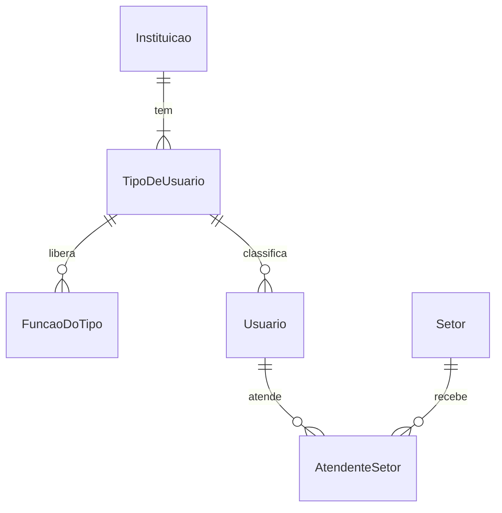

# Tipos de usuário definidos pelos gestores

## Problem

Hoje o que cada pessoa pode fazer na instituição é decidido por três papéis fixos no código (`ALUNO`, `ATENDENTE`, `ADMINISTRADOR`, `Esclari.Api/Dados/Usuarios/Papeis.cs`), e um usuário pode ter vários ao mesmo tempo (tabela `usuario_papel`, `Usuario.Papeis`). Isso falha de três jeitos.

1. Quem administra pode mexer no próprio nível. `PUT /api/admin/usuarios/{id}` (`Esclari.Api/Administracao/Usuarios/AlterarUsuario.cs`) aceitava `papeis` sem olhar quem chama. O conserto pequeno (nenhum gestor altera o próprio nível, o último gestor ativo é protegido) é a feature `papel-do-proprio-gestor`, já construída e publicada (`ValidacaoDeUsuario.UltimoAdministrador`, `409`), e não é repetida aqui; esta feature só estende a regra de `papeis` para `tipoId`.
2. A instituição não escolhe quem faz o quê. Administrar é tudo ou nada: `GrupoAdministrador.SoAdministrador` libera de uma vez usuários com CPF, matrículas, cadastros, fluxos, artigos, documentos, aparência e integrações. Um coordenador que só deveria cuidar da base de conhecimento precisa ser administrador e passa a ver CPF de todos (achado F8 de `.specs/prompt-evolucao-one.md`, LGPD). O contrário também acontece: para ser líder de semestre, o estudante precisa do papel `ATENDENTE` somado ao `ALUNO` e passa em toda checagem `Tem(Papeis.Atendente)` (achado F1). Hoje os líderes de semestre da faculdade são exatamente essas pessoas: alunos com matrícula que também atendem a fila da própria turma.
3. As regras estão espalhadas. `u.Tem(Papeis.…)` aparece em cerca de 35 pontos (`FiltroDeChamados`, `LeitorIndicadores`, `ChamadoDoUsuario`, `TempoRealHub`, `AutenticacaoMcp`, `EquipeDeSetor`, `AvisarAtrasos`, `AvisarValidade`, `Plataforma/*`, `LancamentoMoodle`) e o web repete a lista em `web/src/Autenticado.tsx` (`papeis: [...]` por item de menu) e em `web/src/sessao.ts` (`telaInicial`). Mudar o que um tipo de pessoa pode fazer exige mexer em código.

Quem paga: os gestores de cada instituição, que hoje só podem dar "tudo" ou "quase nada" e não decidem a organização da própria equipe; e o dono do produto, que a cada instituição nova (Univag é a primeira) precisa de uma mudança de código para um tipo de pessoa que a anterior não tinha. Evidência: pedido do dono em 18/11/2026 ("hoje o administrador consegue alterar o próprio nível, o que não deveria; melhor os gestores criarem os tipos de usuário e atribuírem funções a eles; cabe aos gestores decidir quais tipos criar; um usuário só pode estar vinculado a UM tipo"), as respostas do dono no mesmo dia (os líderes de semestre são alunos que também atendem e não podem perder o assistente) e os achados F1 e F8 do plano-mestre. Não há medida de uso, porque não há produção.

Depois disto, os gestores da instituição criam os tipos que quiserem (ex.: "Coordenador de curso", "Gestor de conhecimento"), escolhem para cada tipo funções de uma lista fechada do produto, e cada pessoa tem exatamente um tipo. Um líder de semestre é um tipo próprio ("Líder de semestre") que soma as funções de aluno e a de atender a fila dos setores dele. O tipo do próprio gestor é fixo, de modo que ninguém se tranca fora do sistema.

## Flow

Reusa a sessão que já carrega só o id do usuário e da instituição (`CookieDeSessao.Validar` relê o usuário a cada requisição), as rotas de usuários e de equipe que já existem e o filtro `AddEndpointFilter` de `GrupoAdministrador`; troca a pergunta "tem o papel X?" por "o tipo dele tem a função Y?" sem criar uma segunda forma de autorizar.

1. `POST`/`PUT /api/admin/tipos` -> `Administracao/Usuarios` (exists; a lista fechada de subpastas do AD-056 não tem `Tipos`, então os arquivos entram aqui, no limite de 12 arquivos) - o gestor escolhe nome e funções do catálogo fechado; grava `TipoDeUsuario` e suas funções (door 1, door 2)
2. `POST`/`PUT /api/admin/usuarios` -> `Administracao/Usuarios` (exists) - recebe `tipoId` no lugar de `papeis`, confere que quem atribui tem as funções do tipo (exceto a função de aluno), grava o vínculo único e os setores (door 1, door 4)
3. qualquer rota protegida -> `GrupoAdministrador` (exists) e as checagens de `Chamados`, `Indicadores`, `Conhecimento`, `Mcp`, `Assistente` (exists) - perguntam à política central "o tipo do usuário tem a função?" (door 5), em vez de `Tem(Papeis.…)`
4. `GET /api/auth/me` e `POST /api/auth/login` -> `Acesso` (exists) - devolvem `tipo` e as funções efetivas no lugar de `papeis` (door 4)
5. console da plataforma -> `Plataforma/EquipeDaInstituicao` (exists) - o convite de equipe passa a escolher entre os tipos de sistema `GESTOR` e `ATENDENTE` no lugar de `papeis`; `Plataforma/Criacao` cria os três tipos de sistema junto com a instituição (door 1)
6. importação de matrículas e Moodle/LTI -> `Administracao/Matriculas` e `Acesso/LancamentoMoodle` (exists) - o aluno novo nasce no tipo `ALUNO`; o login pelo Moodle só aceita esse tipo
7. web: `web/src/Autenticado.tsx` e `web/src/sessao.ts` (exists) - o menu e a tela inicial leem `permissoes` de `/api/auth/me`; nova tela "Tipos de usuário" no grupo Administração
8. migration (door 3) - cria os tipos de sistema em cada instituição, cria o tipo "Líder de semestre" onde houver quem o seja e dá a cada usuário existente o tipo equivalente
9. assistente e solicitações -> `Assistente/Conversas` e `Chamados/Consulta` (exists) - `assistente.usar` mais matrícula ativa abre conversa e atendimento direto; as solicitações do próprio usuário seguem por autoria (door 6)

## Impact

| Front | What changes |
| --- | --- |
| domain | novo termo: `Tipo de usuário` - conjunto nomeado de funções, por instituição; cada usuário tem exatamente um. Substitui o papel como unidade de autorização |
| domain | novo termo: `Função` - um código do catálogo fechado do produto (door 2); os gestores marcam funções num tipo, nunca criam uma função |
| domain | novo termo: `Função de aluno` - a função `assistente.usar`; é a única que qualquer gestor pode dar sem ter (door 6). Ter a função implica usar o assistente e o atendimento direto com ao menos uma matrícula ativa, e ver "Minhas solicitações" no menu |
| domain | novo termo: `Líder de semestre` - tipo próprio (não de sistema) que soma `assistente.usar` e `fila.atender`; a regra de liderança (setor com curso e semestre, AD-042) não muda |
| domain | termo existente: `papel` (`ALUNO`/`ATENDENTE`/`ADMINISTRADOR`, vários por usuário) deixa de existir como regra de autorização; quem ramifica nele hoje: `FiltroDeChamados`, `LeitorIndicadores`, `ChamadoDoUsuario`, `ListarChamados`, `RespostasProntasDoSetor`, `TempoRealHub`, `VerVersaoArtigo`, `BaixarVersaoDocumento`, `CriarArtigoDoChamado`, `EquipeDeSetor.SoLideranca`, `AutenticacaoMcp`, `ConversaDoAluno`, `LancamentoMoodle`, `AvisarAtrasos`, `AvisarValidade`, `ReenviarAcesso`, `DesativarMembro`, `ListarEquipe`, `EquipeDaInstituicao`, o filtro de `GrupoAdministrador` e as 6 vezes que `/admin` é mapeado |
| domain | termo existente: o papel de chamado `PermissoesChamado.Aluno/Atendente/Lider/Leitura` não muda; ele é calculado por chamado (solicitante, setor, liderança, leitura de todos) e continua assim. O que muda é só de onde vêm as perguntas "é atendente?" e "é administrador?" que o alimentam |
| domain | termo existente: `ATENDENTE` + setor. Hoje o atendente exige ao menos um setor (`ValidacaoDeUsuario`). Passa a valer para qualquer tipo com a função `fila.atender`, e o gestor com `fila.atender` pode ter zero setores (hoje o administrador sem papel de atendente tem zero) |
| domain | termo existente: usuário com vários papéis vira usuário com um tipo; a regra literal de conversão está na door 3 (`ALUNO`+`ATENDENTE` sem `ADMINISTRADOR` vira "Líder de semestre") |
| domain | termo existente: "administrador" nas mensagens e no e-mail de primeiro acesso vira "gestor" para o tipo `GESTOR`; "atendente" continua para o tipo `ATENDENTE` |
| stored data | migration (door 3): cria 3 tipos de sistema por instituição, o tipo "Líder de semestre" só nas instituições que tiverem quem o seja, grava um tipo em cada usuário existente e deixa `usuario_papel` intacta e sem uso (descartada numa migration futura, com backup) |
| contract | `papeis` sai de `GET /api/auth/me`, `POST /api/auth/login`, de `GET`/`POST`/`PUT /api/admin/usuarios` e das rotas de equipe de `/api/plataforma`; quem lê hoje é só o `web/` deste repositório (door 4) |
| MCP | o token continua valendo para o mesmo usuário; a checagem "atendente ou administrador" vira a função `mcp.usar`, avaliada a cada chamada, então tirar a função do tipo derruba o acesso na chamada seguinte. Os tokens e a tabela `token_mcp` não mudam |
| Moodle e CSV | só o tipo `ALUNO` entra pelo Moodle (`use-senha` para os demais, como hoje para quem tem mais de um papel, inclusive o líder); a importação de matrículas cria usuário novo no tipo `ALUNO` e, se o CPF já existe (inclusive o líder), mantém o tipo atual e só soma a matrícula |
| console da plataforma | o convite de equipe (AD-074) manda `tipo` (`GESTOR` ou `ATENDENTE`) no lugar de `papeis`; as 11 ações de `auditoria_plataforma` não mudam, só o texto do resumo, que mostra o nome do tipo |
| testes | os helpers que montam usuário com a lista de papéis (`Semente.Usuario` na API, `me()` no web) mantêm a assinatura e passam a mapear a lista para tipo e funções, de modo que quase todos os testes existentes não mudam; mudam os que afirmam `papeis`, enviam `papeis` ou afirmam a mensagem 403 de `SoAdministrador`; `ArquiteturaTests` passa a proibir comparar texto de papel fora da política central (mudou a regra, muda o AD primeiro) |
| plano-mestre | entrega a parte "tipo + funções" do E5 de `.specs/prompt-evolucao-one.md` com catálogo fechado de 12 funções; matriz módulo × ação, escopo por curso e auditoria de funções ficam para depois (Out of scope) |

## Relations

Restrições sem volta: `Usuario` tem exatamente um `TipoDeUsuario`, obrigatório e sem exclusão em cascata (door 1); o nome do tipo é único na instituição sem diferenciar maiúsculas (door 1); no máximo um tipo de sistema de cada código por instituição (door 1); `FuncaoDoTipo` guarda o código do catálogo, único por tipo (door 2). `Aluno` e `Gestor` não guardam funções: elas são calculadas (door 6). O tipo "Líder de semestre" é um tipo comum (`sistema` nulo) com funções gravadas: edita e apaga como qualquer tipo próprio. `AtendenteSetor` não muda.

## Surface

Rotas novas ou com assinatura alterada. Todas respondem `401` sem sessão e `403` sem a função exigida (a coluna Status lista os demais).

| Route | In | Out | Status |
| --- | --- | --- | --- |
| `GET /api/admin/tipos` (função `tipos.gerenciar` ou `usuarios.gerenciar`) | - | `tipos[]`: `id`, `nome`, `sistema` (`ALUNO`, `GESTOR`, `ATENDENTE` ou nulo), `funcoes[]`, `usuarios` (contagem); `catalogo[]`: `codigo`, `rotulo`, `descricao`, `expoeDadosPessoais`, `deAluno` | `200`, `401`, `403` |
| `POST /api/admin/tipos` (função `tipos.gerenciar`) | `nome`, `funcoes[]` | o tipo criado, no mesmo formato de `tipos[]` | `201`, `400`, `401`, `403`, `409` |
| `PUT /api/admin/tipos/{id}` (função `tipos.gerenciar`) | `nome`, `funcoes[]` | o tipo alterado | `200`, `400`, `401`, `403`, `404`, `409` |
| `DELETE /api/admin/tipos/{id}` (função `tipos.gerenciar`) | - | sem corpo | `204`, `401`, `403`, `404`, `409` |
| `POST /api/admin/usuarios` (função `usuarios.gerenciar`) | `cpf`, `nome`, `email`, `senhaTemporaria`, `tipoId`, `setores[]` (sai `papeis`) | usuário com `tipo` (`id`, `nome`) no lugar de `papeis` | `201`, `400`, `401`, `403`, `409` |
| `PUT /api/admin/usuarios/{id}` (função `usuarios.gerenciar`) | os mesmos campos | o usuário alterado, com `tipo` | `200`, `400`, `401`, `403`, `404`, `409` |
| `GET /api/admin/usuarios` (função `usuarios.gerenciar`) | `tipoId` opcional | cada usuário com `tipo` no lugar de `papeis` | `200`, `401`, `403` |
| `GET /api/auth/me` | - | `id`, `nome`, `cpfMascarado`, `tipo` (`id`, `nome`), `permissoes[]` (funções efetivas), `deveTrocarSenha`, `instituicao`, `matriculas[]` (sai `papeis`) | `200`, `401` |
| `POST /api/auth/login` | `cpf`, `senha` | mesma troca de `papeis` por `tipo` e `permissoes[]` | `200`, `401`, `429` |
| `POST /api/plataforma/instituicoes/{slug}/equipe` | `cpf`, `nome`, `email`, `tipo` (`GESTOR` ou `ATENDENTE`), `setores[]` (sai `papeis`) | membro com `tipo` no lugar de `papeis` | `201`, `400`, `401`, `404`, `409` |
| `GET /api/plataforma/instituicoes/{slug}/equipe` | - | cada membro com `tipo` no lugar de `papeis` | `200`, `401`, `404` |

Significado dos status novos: `400` nome vazio ou maior que 60, função fora do catálogo, `tipoId` ausente ou de outra instituição, setor faltando; `403` função exigida ausente ou tentativa de dar função (que não seja a de aluno) que quem chama não tem; `404` tipo ou usuário que não existe na instituição; `409` nome repetido, tipo de sistema alterado ou apagado, tipo ainda em uso, limite de 30 tipos, ou a regra de `papel-do-proprio-gestor`.

## Landing

| One-way door | Literal shape | Alternative rejected |
| --- | --- | --- |
| 1. Schema do tipo e do vínculo único | tabela `tipo_usuario` (`instituicao_id` não nulo e query filter global, `nome`, `sistema` anulável, índice único `(instituicao_id, lower(nome))`, índice único `(instituicao_id, sistema)` onde `sistema is not null`); `usuario.tipo_usuario_id` não nulo, FK `ON DELETE RESTRICT`; tabelas e colunas em snake_case | manter `usuario_papel` muitos-para-muitos e só validar "um papel" na aplicação: o banco continuaria aceitando vários e o pedido do dono ("só UM tipo") ficaria sem mecanismo; coluna `tipo` em texto direto no usuário: não deixa os gestores criarem tipos próprios |
| 2. Catálogo fechado de funções e seus códigos | tabela `tipo_usuario_funcao` (`tipo_usuario_id`, `funcao`, único por par) com texto estável; 12 códigos, que nunca se renomeiam depois de gravados: `assistente.usar`, `fila.atender`, `chamados.ver_todos`, `indicadores.ver`, `conhecimento.gerenciar`, `cadastros.gerenciar`, `usuarios.gerenciar`, `matriculas.importar`, `tipos.gerenciar`, `aparencia.gerenciar`, `integracoes.gerenciar`, `mcp.usar`; função nova entra por código e migration, nunca pela tela | matriz módulo × ação (E5 do plano-mestre, ~40 caixas): hoje o código tem só estes 12 pontos de decisão, e as outras caixas seriam funções que nada checa; coluna `jsonb` ou lista de texto no tipo: não dá chave estrangeira nem consulta simples de "quem tem a função X" para os avisos por e-mail; número inteiro por função: ilegível no banco e frágil a reordenação |
| 3. Conversão dos usuários existentes | por instituição, em uma migration, três linhas de `tipo_usuario` com `sistema` `ALUNO` ("Aluno"), `GESTOR` ("Gestor") e `ATENDENTE` ("Atendente", funções gravadas `fila.atender`, `indicadores.ver`, `mcp.usar`); só nas instituições com ao menos um usuário que tenha `ALUNO` e `ATENDENTE` e não tenha `ADMINISTRADOR`, uma quarta linha com `sistema` nulo e nome "Líder de semestre", funções gravadas `assistente.usar`, `fila.atender`, `indicadores.ver`, `mcp.usar` (as do tipo `ATENDENTE` mais a de aluno, o que esses usuários já têm hoje); cada usuário recebe, em ordem: tem `ADMINISTRADOR` -> `GESTOR`; senão tem `ALUNO` e `ATENDENTE` -> "Líder de semestre"; senão tem `ATENDENTE` -> `ATENDENTE`; senão -> `ALUNO`; `atendente_setor` e matrículas ficam como estão; a migration emite `RAISE NOTICE` com o total de usuários que tinham `ALUNO` junto de `ADMINISTRADOR` e por isso perdem o uso do assistente; `usuario_papel` não é apagada | tipo novo por combinação de papéis em toda instituição (ex.: "Atendente e aluno", "Gestor e aluno"): cria tipos que nenhum gestor escolheu mesmo onde ninguém os usa; deixar o líder virar `ATENDENTE` e perder o assistente: contraria a resposta do dono de 18/11 (os líderes são alunos que também atendem); apagar `usuario_papel` na mesma migration: perde o único registro de quem tinha o quê se a regra precisar de ajuste (volta só por backup) |
| 4. Contrato `papeis` -> `tipo` e `permissoes` | `tipo: { id, nome }` e `permissoes: ["fila.atender", ...]` (funções efetivas, ordenadas) em `/api/auth/me` e `/api/auth/login`; `tipo` em `/api/admin/usuarios`; entrada `tipoId`; equipe da plataforma com `tipo` `"GESTOR"` ou `"ATENDENTE"`; `papeis` removido de todos | devolver `papeis` derivado (ex.: `["ADMINISTRADOR"]`) por compatibilidade: finge um modelo de papéis que não existe mais e mantém vivo o `Tem(Papeis.…)`; o único leitor é o `web/` deste repositório, que muda no mesmo conjunto de commits |
| 5. Como as checagens de papel viram funções | uma política central responde "o usuário tem a função F?" a partir do tipo; `GrupoAdministrador` deixa de ter `SoAdministrador` e cada grupo `/admin` exige a sua função: `/admin/usuarios` -> `usuarios.gerenciar`; `/admin/matriculas` -> `matriculas.importar`; setores, categorias, cursos, respostas prontas, fluxos -> `cadastros.gerenciar`; artigos e documentos e `GET /api/conhecimento/validade` -> `conhecimento.gerenciar`; aparência e imagens -> `aparencia.gerenciar`; Moodle e tokens MCP -> `integracoes.gerenciar`; `/admin/tipos` -> `tipos.gerenciar` (o `GET` também aceita `usuarios.gerenciar`, porque o cadastro de usuário lista os tipos). Fora de `/admin`: ver todos os chamados, exportar e indicadores de todos os setores -> `chamados.ver_todos`; fila, lista, respostas prontas do setor, hub de tempo real, criar artigo do chamado -> `fila.atender`; indicadores -> `indicadores.ver`; versões de artigo e documento -> `conhecimento.gerenciar` ou `fila.atender`, e nunca para quem só tem setor de liderança (`SoLideranca` troca "é administrador" por "tem `conhecimento.gerenciar`"); assistente e atendimento direto -> `assistente.usar` com matrícula ativa; acesso por token MCP -> `mcp.usar`. `ArquiteturaTests` falha se alguma comparação com `Papeis.` sobrar fora da política | uma política por rota escrita à mão em cada handler (como é hoje): é a dispersão que causou F1 e F8; atributos `[Authorize(Policy=…)]` por função: o projeto usa filtros de endpoint em minimal APIs, e as regras de chamado dependem do chamado, que um atributo não enxerga |
| 6. Tipos de sistema fixos, funções calculadas e função de aluno | `ALUNO` tem sempre `assistente.usar` e nada mais; `GESTOR` tem sempre todos os 12 códigos exceto `assistente.usar`, calculado em código, não gravado, de modo que um código novo entra sozinho para os gestores; `ATENDENTE` é de sistema (não se apaga nem se renomeia) mas tem funções editáveis e gravadas; só o tipo `GESTOR` pode ter zero setores com `fila.atender`; função efetiva `fila.atender` exige ao menos um vínculo em `atendente_setor`. A função de aluno é só `assistente.usar`: ela fica fora da regra "só dá o que tem" (qualquer gestor com `tipos.gerenciar` a inclui num tipo, mesmo sem ter), porque não expõe dado da instituição e é o que permite montar o "Líder de semestre". Ter `assistente.usar` exige matrícula ativa para abrir conversa ou atendimento direto (`403` com a mensagem de hoje se não tiver), e as conversas e solicitações que a pessoa já abriu continuam acessíveis por autoria mesmo se o tipo perder a função | gravar as funções do `GESTOR` como linhas: um código novo deixaria os gestores sem a função nova e trancaria a instituição fora da tela correspondente; gestor editável: permitiria tirar `tipos.gerenciar` e `usuarios.gerenciar` de todos e deixar a instituição sem quem conserte (o pedido (b) do dono); dar `assistente.usar` ao `GESTOR` calculado: faria todo gestor ver o assistente e "Minhas solicitações" sem ser aluno, e o dono não pediu; várias funções de aluno (abrir, acompanhar, matrículas): o código hoje decide a conversa por uma só pergunta e acompanhar solicitação é por autoria, então as outras seriam caixas que nada checa |
| 7. Nomes de tabela e código de erro do `ON DELETE RESTRICT` (achado no L1) | tabelas `tipo_usuario` e `tipo_usuario_funcao` para as entidades `TipoDeUsuario` e `FuncaoDoTipo` (`EsclariDb.Tabela`); o banco recusa apagar tipo em uso com SQLSTATE `23001` (`restrict_violation`), o código que o PostgreSQL dá a `ON DELETE RESTRICT`, e não `23503` (que só `NO ACTION` dá): quem apanha a recusa no L2 (C30, C54) trata `23001` | trocar a FK para `NO ACTION` só para devolver `23503`: contraria a door 1 aprovada; nome de tabela `tipo_de_usuario` pelo snake_case do nome da classe: contraria a door 1 |
| 8. Versões de artigo e documento pela função do tipo (achado no L1) | `VerVersaoArtigo` e `BaixarVersaoDocumento` perguntam se o **tipo** libera `conhecimento.gerenciar` ou `fila.atender` (`Usuario.TipoLibera`), sem exigir vínculo de setor; as demais checagens de `fila.atender` usam a função efetiva (com setor). Mantém os 200 de hoje do atendente sem setor (`LiderSemVazamentoTests.Quem_nao_e_so_lider_segue_como_hoje`, `ArtigoAdminTests`, `VersaoCitadaTests`) | exigir setor também nessas duas rotas: mudaria o status de um atendente sem setor de 200 para 404 e quebraria asserções existentes fora da lista de mudanças |
| 9. Onde ficam a política e a ponte (achado no L1) | `Esclari.Api/PoliticaDeAcesso.cs` (raiz: `ComTipo`, `TemFuncao` para consultas, busca e criação de tipos de sistema por `EsclariDb`), `Dados/Usuarios/Funcoes.cs` (catálogo), `Usuario.Pode` e `Usuario.FuncoesEfetivas` (função efetiva) e `GrupoAdministrador.ExigirFuncao`; a ponte `Dados/Usuarios/PonteDePapeis.cs` é pura (sem EF) porque `Dados` não referencia o EF Core | pôr as consultas em `Dados/Usuarios`: `ArquiteturaTests.Dados_sem_EfCore` proíbe |

- A tabela `usuario_papel` e a coluna que ela guardava ficam órfãs até uma migration de limpeza futura, com backup (decisão do dono, 18/11/2026); nenhuma outra decisão desta feature é difícil de desfazer
- Decisão que ultrapassa a feature (catálogo fechado, tipo único, tipos de sistema, líder como tipo próprio, conversão): `AD-076` no `STATE.md`, registrado junto com a aprovação do plano

## Criteria

### S1: autorização por função, com o mesmo comportamento de hoje (P1)

Cada pessoa tem um tipo, o tipo tem funções, e tudo que hoje depende de papel passa a depender de função, sem mudar o que cada pessoa vê ou faz.

**Acceptance Criteria**

1. The system SHALL aceitar somente os 12 códigos de função da door 2 e recusar qualquer outro texto onde um código for recebido
2. WHEN a migration roda THEN the system SHALL criar em cada instituição os tipos de sistema `ALUNO`, `GESTOR` e `ATENDENTE` e dar a cada usuário existente o primeiro que servir na ordem `ADMINISTRADOR` -> `GESTOR`, `ALUNO` e `ATENDENTE` -> "Líder de semestre", `ATENDENTE` -> `ATENDENTE`, nenhum deles -> `ALUNO`
3. WHEN a migration roda THEN the system SHALL manter intactos os vínculos de `atendente_setor`, os dados de matrícula e a tabela `usuario_papel`
4. WHEN a migration roda e há usuário com `ALUNO` junto de `ADMINISTRADOR` THEN the system SHALL emitir um aviso com o total dessas pessoas por instituição, que passam a `GESTOR` e perdem o uso do assistente
5. The system SHALL calcular as funções de `GESTOR` como todos os 12 códigos menos `assistente.usar` e as de `ALUNO` como só `assistente.usar`, sem depender de linhas gravadas
6. WHILE um usuário não tem nenhum vínculo de setor, the system SHALL tratar como ausente a função `fila.atender` dele
7. WHEN o usuário chama uma rota que exige uma função que o tipo dele não tem THEN the system SHALL responder `403` com `Seu tipo de usuário não tem acesso a esta área.`
8. WHEN o gestor muda as funções de um tipo ou o tipo de um usuário THEN the system SHALL aplicar a mudança na requisição seguinte do usuário afetado, sem novo login
9. The system SHALL manter os mesmos status e corpos de resposta das rotas existentes para os usuários dos tipos `ALUNO`, `ATENDENTE` e `GESTOR` que os de hoje para os papéis equivalentes, exceto os campos `papeis`
10. WHEN uma pessoa do tipo `GESTOR` tem setores vinculados THEN the system SHALL atribuir a ela, nos chamados desses setores, o papel de chamado `ATENDENTE` ou `LIDER` de hoje, e a leitura (`LEITURA`) nos demais
11. WHEN `AvisarAtrasos`, `AvisarValidade` ou o reenvio de acesso escolhe destinatários THEN the system SHALL usar os usuários ativos com e-mail cujo tipo tem `chamados.ver_todos` (atrasos), `conhecimento.gerenciar` (validade) e `usuarios.gerenciar` (reenvio), e os atendentes do setor pela função `fila.atender`
12. WHEN um token MCP válido é apresentado e o usuário está ativo, sem troca de senha pendente e com a função `mcp.usar` THEN the system SHALL autenticar a chamada
13. IF o usuário do token MCP não tem `mcp.usar` THEN the system SHALL responder `401` à chamada
14. WHEN `GET /api/auth/me` ou `POST /api/auth/login` responde `200` THEN the system SHALL devolver `tipo` com `id` e `nome` e `permissoes` com as funções efetivas ordenadas, e nenhum campo `papeis`
15. The system SHALL decidir toda autorização pelas funções do tipo, sem comparar texto de papel fora da política central

**Independent test:** migrar um banco com um aluno, um atendente com setor, um administrador, um administrador+atendente e um aluno+atendente com setor de liderança; cada um chama as mesmas rotas de antes e recebe os mesmos status.

### S2: os gestores criam e mantêm os tipos (P1)

Quem tem `tipos.gerenciar` cria, edita e apaga tipos próprios, escolhendo funções do catálogo.

**Acceptance Criteria**

16. WHEN quem tem `tipos.gerenciar` envia `POST /api/admin/tipos` com nome e funções válidos THEN the system SHALL criar o tipo na instituição da sessão e responder `201` com `id`, `nome`, `sistema` nulo, `funcoes` e `usuarios` 0
17. IF o nome está vazio ou tem mais de 60 caracteres THEN the system SHALL responder `400` com o campo `nome`
18. IF alguma função enviada não está no catálogo THEN the system SHALL responder `400` com o campo `funcoes`
19. IF o nome já existe na instituição, sem diferenciar maiúsculas THEN the system SHALL responder `409`
20. IF a instituição já tem 30 tipos THEN the system SHALL responder `409` ao criar outro
21. WHEN quem tem `tipos.gerenciar` envia `PUT /api/admin/tipos/{id}` de um tipo próprio ou do tipo de sistema `ATENDENTE` com funções válidas THEN the system SHALL gravar o novo conjunto e responder `200`
22. IF o `PUT` muda o nome do tipo `ATENDENTE` ou altera qualquer coisa de `GESTOR` ou `ALUNO` THEN the system SHALL responder `409` e nada muda
23. IF quem chama inclui uma função que o próprio tipo dele não tem, e que não é `assistente.usar`, THEN the system SHALL responder `403` e nada muda
24. WHEN o `DELETE /api/admin/tipos/{id}` é de um tipo próprio sem usuários THEN the system SHALL apagar e responder `204`
25. IF o tipo a apagar tem usuários THEN the system SHALL responder `409` com a quantidade (`N usuário(s) usam este tipo.`)
26. IF o tipo a apagar é de sistema THEN the system SHALL responder `409`
27. IF o `id` não existe na instituição da sessão, inclusive se é de outra instituição, THEN the system SHALL responder `404`
28. WHEN `GET /api/admin/tipos` é chamado THEN the system SHALL devolver os tipos da instituição com a contagem de usuários e o catálogo das 12 funções, cada uma com `rotulo`, `descricao`, `expoeDadosPessoais` e `deAluno`
29. IF alguém sem `tipos.gerenciar` chama `POST`, `PUT` ou `DELETE /api/admin/tipos`, ou chama `GET /api/admin/tipos` sem `tipos.gerenciar` e sem `usuarios.gerenciar`, THEN the system SHALL responder `403`
30. WHEN dois gestores apagam e atribuem o mesmo tipo ao mesmo tempo THEN the system SHALL deixar a chave estrangeira recusar o `DELETE` e responder `409`, sem usuário sem tipo

**Independent test:** pelo web ou por HTTP, criar "Coordenador de curso" com `indicadores.ver` e `cadastros.gerenciar`, editar, tentar apagar com um usuário vinculado (`409`), desvincular e apagar (`204`).

### S3: cada usuário tem um único tipo (P1)

Atribuir ou trocar o tipo é um campo só no cadastro do usuário, com proteção contra se dar poder ou se trancar.

**Acceptance Criteria**

31. WHEN quem tem `usuarios.gerenciar` envia `POST` ou `PUT /api/admin/usuarios` com `tipoId` válido THEN the system SHALL vincular o usuário a esse único tipo e devolver `tipo` com `id` e `nome`
32. IF `tipoId` falta, não existe ou é de outra instituição THEN the system SHALL responder `400` com o campo `tipoId`
33. IF o tipo escolhido tem `fila.atender`, não é `GESTOR` e nenhum setor foi enviado THEN the system SHALL responder `400` com o campo `setores`
34. WHEN o tipo escolhido não tem `fila.atender` THEN the system SHALL remover os vínculos de setor do usuário
35. IF quem atribui não tem alguma das funções do tipo novo, ou não tem alguma das funções do tipo atual do usuário, descontada `assistente.usar` nos dois casos, THEN the system SHALL responder `403` com `Você não pode atribuir ou retirar um tipo com funções que o seu tipo não tem.`
36. WHEN o usuário que chama altera o próprio `tipoId`, ou a troca deixaria a instituição sem gestor ativo THEN the system SHALL aplicar a regra de `papel-do-proprio-gestor` (`409`), estendida de `papeis` para `tipoId`
37. WHEN a importação de matrículas encontra um CPF novo THEN the system SHALL criar o usuário no tipo `ALUNO`
38. WHEN a importação de matrículas encontra um CPF que já existe THEN the system SHALL manter o tipo do usuário e somar a matrícula
39. IF um usuário que não é do tipo `ALUNO` tenta entrar pelo Moodle THEN the system SHALL redirecionar com o motivo `use-senha`
40. WHEN `GET /api/admin/usuarios` é chamado THEN the system SHALL listar cada usuário com `tipo`

**Independent test:** criar um usuário "Coordenador de curso" com dois setores; trocar para `ALUNO` e ver os setores sumirem; tentar trocar o próprio tipo e receber `409`.

### S4: o console da plataforma convida por tipo (P1)

O operador continua criando a primeira equipe, agora com o tipo no lugar dos papéis.

**Acceptance Criteria**

41. WHEN o operador cria uma instituição THEN the system SHALL criar os três tipos de sistema antes do primeiro administrador, na mesma transação, e dar a ele o tipo `GESTOR`
42. WHEN o operador envia `POST .../equipe` com `tipo` `GESTOR` ou `ATENDENTE` THEN the system SHALL convidar o membro nesse tipo, com link de primeiro acesso de 60 minutos, como no AD-074
43. IF `tipo` não é `GESTOR` nem `ATENDENTE` THEN the system SHALL responder `400` com o campo `tipo`
44. IF o tipo é `ATENDENTE` e não há setor THEN the system SHALL responder `400` com o campo `setores`
45. WHEN o operador lista a equipe THEN the system SHALL mostrar os usuários de qualquer tipo que não seja `ALUNO`, cada um com `tipo`; reconvidar, desativar e reativar valem para todos eles
46. WHEN o operador age sobre a equipe THEN the system SHALL registrar a ação em `auditoria_plataforma` com o nome do tipo no resumo, sem criar ação nova

**Independent test:** criar a instituição `demo-tipos` pelo console, convidar um atendente e um gestor, e abrir o link de cada um.

### S5: o web segue as funções (P1)

Menu, tela inicial e telas de gestão leem o tipo e as funções.

**Acceptance Criteria**

47. WHEN o web monta o menu THEN the system SHALL mostrar cada item só se `permissoes` contém a função que o item exige
48. WHEN a pessoa entra THEN the system SHALL abrir `assistente` se tem `assistente.usar`, senão `fila` se tem `fila.atender`, senão a primeira tela visível do menu
49. IF o tipo da pessoa não tem nenhuma função com tela THEN the system SHALL mostrar a mensagem `Seu tipo de usuário ainda não tem funções liberadas. Fale com o gestor da sua instituição.`
50. WHEN quem tem `tipos.gerenciar` abre a tela "Tipos de usuário" no grupo Administração THEN the system SHALL listar os tipos com nome, quantidade de usuários e funções
51. WHEN a pessoa marca funções no formulário do tipo THEN the system SHALL mostrar o `rotulo` e a `descricao` de cada função e um aviso nas que têm `expoeDadosPessoais`
52. WHEN a pessoa pede para apagar um tipo THEN the system SHALL pedir confirmação com o nome do tipo antes de enviar o `DELETE`
53. WHEN o cadastro de usuário é aberto THEN the system SHALL mostrar um campo "Tipo" de escolha única no lugar das caixas de papel e só mostrar os setores se o tipo tem `fila.atender`

**Independent test:** entrar como "Coordenador de curso" (só `indicadores.ver` e `cadastros.gerenciar`) e ver só esses itens no menu.

### S6: acabamento (P2)

**Acceptance Criteria**

54. WHERE a tela de usuários tem filtro, the system SHALL filtrar a lista por tipo com `GET /api/admin/usuarios?tipoId=`
55. WHEN a tela "Tipos de usuário" mostra um tipo com usuários THEN the system SHALL levar da contagem para a lista de usuários já filtrada por esse tipo

**Independent test:** clicar na contagem de um tipo e cair na lista de usuários desse tipo.

### S7: o líder de semestre segue sendo aluno e atendente (P1)

Quem hoje é líder (aluno com matrícula que também atende a fila da própria turma) não perde nada; um gestor monta o mesmo tipo para os próximos.

**Acceptance Criteria**

56. WHEN a migration roda e a instituição tem usuário com `ALUNO` e `ATENDENTE` e sem `ADMINISTRADOR` THEN the system SHALL criar nela o tipo "Líder de semestre" (`sistema` nulo) com as funções `assistente.usar`, `fila.atender`, `indicadores.ver` e `mcp.usar` e dar o tipo a esses usuários, mantendo os setores e as matrículas
57. WHEN a migration roda e a instituição não tem esse usuário THEN the system SHALL NOT criar o tipo "Líder de semestre" nela
58. WHEN um usuário do tipo "Líder de semestre" com matrícula ativa e setor de liderança usa o sistema THEN the system SHALL manter o comportamento de hoje: abre conversa com o assistente (`201`), vê as próprias solicitações, vê a fila da turma com o papel de chamado `LIDER` e não vê transcrição, matrícula nem anexos da conversa
59. IF o usuário tem `assistente.usar` e nenhuma matrícula ativa THEN the system SHALL responder `403` em `POST /api/conversas` e em `POST /api/atendimento-direto` com as mensagens de hoje
60. WHEN quem tem `tipos.gerenciar` mas não tem `assistente.usar` envia `assistente.usar` num tipo THEN the system SHALL aceitar (`201` ou `200`), e a mesma exceção não vale para nenhum dos outros 11 códigos
61. WHEN `permissoes` tem `assistente.usar` e `fila.atender` THEN the system SHALL mostrar no menu o Assistente, "Minhas solicitações", a Fila e os Indicadores (se tem `indicadores.ver`), abrir a tela `assistente` na entrada e oferecer os avisos de push do aluno
62. WHEN o líder abre uma solicitação como solicitante THEN the system SHALL excluí-lo da liderança que recebe a própria solicitação, como `ConsultasDeFluxo.Lideranca` faz hoje

**Independent test:** migrar um banco com um aluno+atendente de setor de liderança e entrar como ele: o menu mostra Assistente, Minhas solicitações, Fila e Indicadores, e a conversa com o assistente abre.

## Out of scope

| Excluded | Why |
| --- | --- |
| Mais de um tipo por usuário | pedido do dono: um usuário em UM tipo só |
| Funções criadas pelos gestores | pedido (c) confirmado pelo dono: lista fechada no código, porque cada função precisa de uma checagem que só o código sabe fazer |
| Matriz módulo × ação e escopo por curso ou semestre (E5 completo) | os 12 pontos de decisão de hoje cabem em 12 funções; o escopo hoje é o setor, que já existe em `atendente_setor` |
| Mudar a regra de liderança (setor com curso e semestre, no máximo um ativo por turma, aceite do aluno) | AD-042; o líder passa a ser um tipo, a regra de liderança não muda |
| Auditoria de quem deu ou tirou função e histórico de mudança de tipo | decisão do dono (18/11/2026): feature própria depois; o histórico de ações do operador (AD-073) não cobre os gestores |
| Clonar tipo, ações em lote, filtros avançados | acabamento sem pedido do dono |
| Operador criar tipos próprios ou convidar para tipo próprio | o convite do AD-074 fica nos dois tipos de sistema; os gestores montam o resto |
| Apagar a tabela `usuario_papel` | decisão do dono (18/11/2026): migration de limpeza futura, com backup |
| Conta de operador da plataforma | tabela e login próprios (AD-073); não tem tipo |
| O conserto "ninguém altera o próprio nível, o último gestor é protegido" | feature `papel-do-proprio-gestor`, já construída; esta apenas estende a regra de `papeis` para `tipoId` |
| Usuário `ALUNO`+`ADMINISTRADOR` manter o assistente | não foi pedido; vira `GESTOR` e o aviso da migration conta quantos são. Um gestor que também estuda pede um tipo próprio com as funções que quiser |

## Assumptions

| Assumption | Chosen default | Rationale | Confirmed? |
| --- | --- | --- | --- |
| (a) O tipo Aluno | fixo, nasce da matrícula e do Moodle, fora da escolha dos gestores | o aluno é quem o assistente atende e quem abre chamado; não faz parte da equipe que os gestores organizam | y (dono, 18/11/2026) |
| (b) O tipo do gestor | fixo: não se apaga, não se renomeia e não perde `tipos.gerenciar` nem `usuarios.gerenciar`; funções calculadas | ninguém se tranca fora do sistema | y (dono, 18/11/2026) |
| (c) As funções | lista fechada de 12 códigos no código; os gestores escolhem, não inventam | cada função só existe se uma checagem a usa | y (dono, 18/11/2026) |
| Quando construir | agora, antes da banca de 20/11, em lotes por sub-agentes | o dono pediu a construção imediata e o uso de sub-agentes; o congelamento do AD-072 já foi levantado para as features anteriores | y (dono, 18/11/2026) |
| Líderes de semestre | são alunos que também atendem; viram o tipo "Líder de semestre" (`assistente.usar`, `fila.atender`, `indicadores.ver`, `mcp.usar`), criado por instituição só se existir quem o seja | resposta do dono à pergunta "quem hoje é `ALUNO` com papel de equipe": os líderes de semestre da faculdade; as funções são as que eles têm hoje | y (dono, 18/11/2026) |
| Função de aluno | é só `assistente.usar`; exige matrícula ativa para abrir conversa e atendimento direto; acompanhar o que já abriu é por autoria; fora da regra "só dá o que tem" | o código hoje tem uma pergunta só (`ConversaDoAluno.PodeUsarAssistente`); sem a exceção nenhum gestor monta um líder, porque o `GESTOR` não tem a função | n |
| Um tipo próprio pode receber `tipos.gerenciar` e `usuarios.gerenciar` | permitido, com a regra de que só se dá o que se tem (critérios 23 e 35) | resposta do dono: fazer a recomendação | y (dono, 18/11/2026) |
| Histórico das mudanças de tipo e de funções | fora desta feature; feature própria depois | resposta do dono: fazer a recomendação | y (dono, 18/11/2026) |
| Tabela `usuario_papel` | fica intacta e sem uso nesta feature; descartada numa migration futura, com backup | resposta do dono: fazer a recomendação | y (dono, 18/11/2026) |
| Usuário com `ADMINISTRADOR`+`ATENDENTE` | vira `GESTOR` e mantém os setores; o `GESTOR` inclui `fila.atender` | é o caso comum de "ou os dois" do AD-074; sem isso o gestor deixaria de atender | n |
| Usuário com `ALUNO`+`ADMINISTRADOR` | vira `GESTOR` e perde o assistente; o total sai no aviso da migration | o dono tratou só o líder; não há produção, e o gestor monta um tipo próprio se precisar | n |
| Nome e limite de tipos | nome de 1 a 60 caracteres, único sem diferenciar maiúsculas, até 30 tipos por instituição | evita lista inviável no celular; números sem pesquisa de uso | n |
| Quem pode dar funções | só funções que o próprio tipo de quem atribui tem (com a exceção da função de aluno), vale para criar tipo, editar tipo e atribuir tipo | impede um tipo intermediário de promover alguém acima de si; regra própria, não copiada de nenhum produto | n |
| Funções ao remover `fila.atender` de um tipo | os vínculos de setor ficam gravados e inertes; chamados já atribuídos continuam com o responsável | reversível ao marcar a função de novo; não reatribui nada sozinho | n |
| Equipe vista pelo operador | todo usuário que não é `ALUNO` aparece e pode ser reconvidado, desativado e reativado; só se convida para `GESTOR` e `ATENDENTE` | o operador não pode perder de vista quem tem acesso a dados da instituição; o líder (tipo próprio) aparece | n |
| Texto do e-mail de primeiro acesso | "gestor" para `GESTOR` e "atendente" para `ATENDENTE` | o dono chama os administradores de gestores | n |
| Quem lê a lista de tipos | `tipos.gerenciar` ou `usuarios.gerenciar` no `GET /api/admin/tipos`; criar, alterar e apagar só com `tipos.gerenciar` | o campo "Tipo" do cadastro de usuário precisa da lista, e quem cuida de usuários sem cuidar de tipos não pode ficar sem ela | n |
| Tipo sem nenhuma função | permitido; a pessoa vê a mensagem do critério 49 | evita bloquear tipos em montagem; o gestor vê a contagem de usuários | n |
| Função `assistente.usar` num tipo próprio | permitida; o assistente continua exigindo matrícula ativa | o conserto exigiria nova checagem sem pedido | n |
| Pesquisa de mercado como base | Zendesk e Freshdesk dão a cada agente um papel de uma lista de padrão e personalizados; GLPI separa o perfil do escopo | a literatura é referência, não obrigação; a regra de "um tipo" é do dono | n |

**Open questions:** None - as quatro perguntas do plano anterior foram respondidas pelo dono em 18/11/2026 e estão nas Assumptions com `y`: os líderes de semestre mantêm as funções de aluno (critérios 56 a 62), tipo próprio pode receber `tipos.gerenciar` e `usuarios.gerenciar`, `usuario_papel` fica intacta e o histórico de mudanças fica para depois.

## Observable

Worksheet, não a revisão. `n/a` leva o motivo.

| Surface | Decision | Landing |
| --- | --- | --- |
| screen "Tipos de usuário" | empty state (só os tipos de sistema) | AC 50, AC 28 |
| screen "Tipos de usuário" | loading state | existing - esqueleto e `TanStack Query` das outras telas de Administração |
| screen "Tipos de usuário" | error state (`400`, `403`, `409`, falha de rede) | AC 17 a 20, AC 22, AC 25, AC 26; mensagem do servidor no formulário e `Sonner` para falha de rede, como nas outras telas |
| screen "Tipos de usuário" | unauthorised | AC 29, AC 47 |
| screen "Tipos de usuário" | density and ordering | AC 50: sistema primeiro, depois por nome; funções agrupadas por assunto no formulário |
| screen "Tipos de usuário" | destructive action confirms | AC 52 |
| screen "Usuários" | empty, loading, error | existing - tela de usuários já tem os três; muda só o campo Tipo (AC 53) |
| screen "Usuários" | unauthorised | AC 47 |
| screen de entrada sem funções | empty state | AC 49 |
| screen de menu | ordering and visibility | AC 47, AC 48, AC 61 |
| API `/api/admin/tipos*` | error shape and codes | AC 16 a 30, ProblemDetails como o resto da API |
| API `/api/admin/tipos*` | who may call | AC 29 |
| API `/api/admin/usuarios*`, `/api/auth/*`, `/api/plataforma/.../equipe` | response shape and error shape | AC 14, AC 31 a 36, AC 40, AC 42 a 45 |
| API `/api/admin/tipos*` | versioning | n/a - a API não é versionada; o único cliente é o `web/` do mesmo repositório |
| API `/api/admin/tipos*` | rate limit | n/a - só o login tem limite (`429`), e as rotas de gestão já ficam atrás de sessão e função |
| command/migration | output and failure halfway | AC 2 a 4, AC 56, AC 57; a migration roda numa transação e falha inteira, sem tipo pela metade |
| celular 360×780 | `Tipos de usuário`: lista em uma coluna, formulário em uma coluna, funções em lista vertical; nenhum corte horizontal | AC 50, AC 51 |
| celular deitado 844×390 | formulário rola dentro da tela com o botão de salvar ao alcance, sem cobrir campos | AC 51 |
| teclado aberto | o campo de nome continua visível ao digitar e o botão de salvar não o esconde | AC 51 |
| toque | caixas de função, botões e seletor de tipo com alvo de ao menos 44 px, sem ação só por passar o mouse; apagar pede confirmação | AC 51, AC 52, AC 53 |
| nine dimensions: validation and bounds | nome 1 a 60, 30 tipos, códigos fechados | AC 1, AC 17 a 20 |
| nine dimensions: failure and partial failure | migration em transação; tipo e funções gravados juntos | AC 2, AC 16 |
| nine dimensions: idempotency, retry, duplicates | nome repetido recusado por índice único | AC 19 |
| nine dimensions: authorization | função por rota; ninguém dá o que não tem, salvo a função de aluno | AC 7, AC 23, AC 29, AC 35, AC 60 |
| nine dimensions: concurrency and ordering | `DELETE` contra atribuição simultânea: FK recusa | AC 30 |
| nine dimensions: data lifecycle | tipo em uso não se apaga; `usuario_papel` fica órfã por decisão do dono | AC 25, AC 3 |
| nine dimensions: external-dependency failure | n/a - nenhuma chamada externa nova; o convite continua na fila de e-mail do AD-074 | n/a - sem dependência nova |
| nine dimensions: state transitions | tipo próprio -> apagado só sem usuários; usuário troca de tipo com regra do gestor | AC 24 a 26, AC 36 |
| nine dimensions: observability | n/a - sem auditoria nesta feature por decisão do dono (18/11/2026); o histórico de mudanças é feature própria | n/a - fora do escopo por decisão registrada |

## Sources

- Pedido do dono do projeto, 18/11/2026 (texto na seção Problem) e suas respostas do mesmo dia (líderes de semestre são alunos que também atendem; tipo próprio pode receber `tipos.gerenciar` e `usuarios.gerenciar`; histórico fica para depois; construir agora; `usuario_papel` intacta) - definem "tipo de usuário", um tipo por usuário, os gestores decidem
- `.specs/prompt-evolucao-one.md`, achados F1 e F8 e épico E5 - origem do problema, do catálogo e da migração
- `.specs/STATE.md`, AD-008 (instituição por tabela), AD-017 e AD-056 (fatias e subpastas), AD-042 (liderança), AD-073 e AD-074 (operador e convite de equipe), AD-076 - restrições que o plano segue
- [Zendesk: criação de funções personalizadas](https://support.zendesk.com/hc/en-us/articles/203662026) - funções personalizadas por administradores; agente não altera a própria atribuição
- [Freshdesk: gerenciar funções de agentes](https://support.freshdesk.com/support/solutions/articles/96909-manage-agent-roles) e [Freshdesk: criar função personalizada](https://support.freshdesk.com/support/solutions/articles/97077-how-to-create-a-new-custom-role-and-why-) - todo agente recebe ao menos uma função e as personalizadas listam permissões por área
- [GLPI: perfis de usuário](https://glpi-user-documentation.readthedocs.io/fr/latest/modules/administration/profiles/profiles.html) e [GLPI: controle de acesso](https://glpi-user-documentation.readthedocs.io/fr/latest/first-steps/access-glpi.html) - perfil é um conjunto de permissões; vários perfis por usuário, um ativo por vez (o Esclari escolhe um só, por pedido do dono)
- [Jira Service Management: esquemas de permissão](https://confluence.atlassian.com/jirakb/using-custom-permission-schemes-838416600.html) - permissões atribuídas a funções do projeto (administradores, equipe, clientes)
