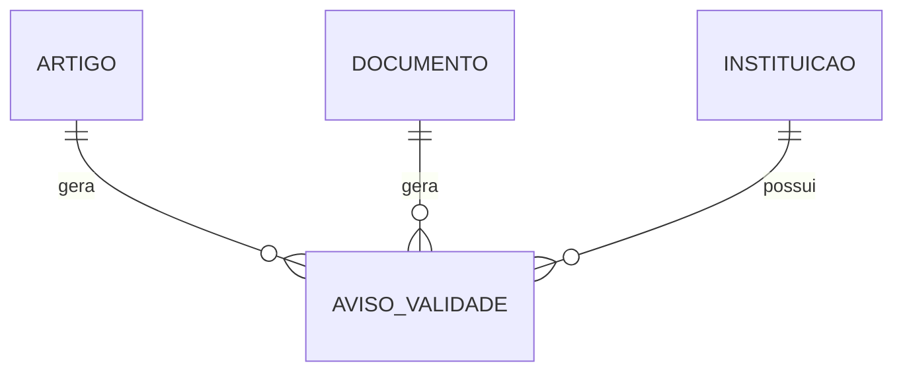

# Validade de um ano para artigos e documentos

## Problem

Hoje um artigo ou documento publicado vale para sempre. O único limite é `VisivelAte` do artigo, um campo opcional que o gestor precisa lembrar de preencher; o documento não tem nenhum. O assistente (RAG) e o MCP `buscar` citam o conteúdo enquanto o estado for `ATIVO`, então uma regra de calendário, de abono de falta ou de matrícula que mudou continua sendo respondida ao aluno com a versão antiga, e ninguém é avisado. Quem paga é o aluno, que recebe uma orientação errada com citação de fonte oficial, e o gestor, que descobre o erro só quando um chamado reclama.

Evidência do pedido: o dono do projeto (relato de 17/11/2026, na devolutiva da banca) pediu que documentos e artigos tenham validade padrão de 1 ano e que os gestores sejam notificados para renovar. Não há medida de uso, porque não há produção. A literatura de governança de base de conhecimento aponta o mesmo ciclo: dono, data de revisão, lembrete antes de vencer e retirada do conteúdo vencido do uso ([ONES](https://ones.com/blog/how-to-manage-expiring-procedures-in-a-shared-knowledge-base/), [GB Advisors](https://www.gb-advisors.com/blog/knowledge-base-governance-a-guide-for-it-teams)); a Universidade de Illinois revisa a cada 6 meses ([Illinois](https://answers.illinois.edu/systemoffices/105051)), e o pedido aqui é 12.

Depois disto, todo artigo e documento tem uma data de validade (padrão: um ano a partir da publicação ou da última revisão), o administrador recebe e-mail 30 dias e 7 dias antes e no dia seguinte ao vencimento, vê o que está vencendo nas listas e no painel, renova com um clique, e o assistente deixa de citar o que venceu.

## Flow

Reusa a fila de `EmailSaida` (e-mail com tentativas), o `Agendador` com `ITarefaAgendada`, o filtro único de fontes em `BuscarFontes` (que o assistente e o MCP já compartilham) e a tela `Indicadores` já montada por perguntas do gestor (AD-060).

1. `Artigo.Criar`/`NovaVersao` e `Documento.Criar`/`NovaVersao` (exists) - gravam a validade em hoje + 12 meses no fuso da instituição (door 1)
2. `POST /api/artigos/{id}/renovar` e `POST /api/documentos/{id}/renovar` (new, rotas em `Conhecimento/Artigos` e `Conhecimento/Documentos`) - refazem a validade sem criar versão
3. `BuscarFontes.Buscar` (exists) - exclui artigo e documento com validade anterior a hoje; assistente e MCP herdam
4. `AvisarValidade` (new, `ITarefaAgendada`, door 2) - por instituição, acha itens `ATIVO` que cruzaram um marco, grava `aviso_validade` e enfileira um `EmailSaida` por administrador ativo, numa transação só
5. `ListarArtigos`/`ListarDocumentos` (exists) - devolvem `validoAte` e `validade`; as telas `Artigos` e `Documentos` mostram a etiqueta, o filtro e o botão "Renovar"
6. `GET /api/conhecimento/validade` (new, door 3) - contagens para a seção "Base de conhecimento" da tela `Indicadores`

## Impact

| Front | What changes |
| --- | --- |
| domain | novo termo: `validade` - a data até a qual o conteúdo pode ser citado; vive em `Artigo` e `Documento`, nunca vira estado gravado |
| domain | termo existente: `VisivelAte` do artigo continua sendo a janela de publicação escolhida pelo gestor; a disponibilidade passa a ser `ATIVO` e dentro da janela e `validoAte >= hoje`. Quem ramifica nele hoje: `BuscarFontes.ArtigosBuscaveis` |
| domain | termo existente: "fonte publicada" (AGENTS.md, assistente só responde com fontes publicadas) passa a exigir validade em dia. Quem ramifica nele hoje: `BuscarFontes.Buscar`, o RAG (`Assistente/Respostas`) e `FerramentasMcp` (busca) |
| API | `GET /api/artigos` e `GET /api/documentos` ganham `validoAte` e `validade` (aditivo); o MCP `buscar` mantém o mesmo formato de saída (AD-055) e passa a devolver menos fontes |
| stored data | migration: toda linha existente de `artigo` e `documento` recebe validade = data da migration + 12 meses, para nada nascer vencido e o assistente não ficar mudo no primeiro dia |
| stored data | trechos indexados (`TrechoFonte`) não mudam: o filtro é na busca, então renovar não reindexa |
| config | `Prazos:ValidadeConhecimentoMeses` (padrão 12), lido em `Prazos.cs` como os outros |
| tests | testes de `BuscarFontes`/RAG que criam fontes ficam com validade em dia por padrão; nenhum teste existente deve mudar de asserção |

## Relations

One-way constraints: `aviso_validade` é único por instituição, tipo do item, item, data de validade e marco (door 2); `artigo` e `documento` passam a ter validade obrigatória (door 1). O item referenciado por `aviso_validade` é polimórfico (tipo + id), sem chave estrangeira. Sem colunas e sem tipos aqui além dos que são porta.

## Surface

| Route | In | Out | Status |
| --- | --- | --- | --- |
| `POST /api/artigos/{id}/renovar` | `id` | o artigo com `validoAte` e `validade` | `200`, `401`, `403`, `404`, `409` |
| `POST /api/documentos/{id}/renovar` | `id` | o documento com `validoAte` e `validade` | `200`, `401`, `403`, `404`, `409` |
| `GET /api/conhecimento/validade` | nada | `artigos` e `documentos`, cada um com `vigentes`, `venceEm30Dias`, `vencidos` | `200`, `401`, `403` |

## Landing

| One-way door | Literal shape | Alternative rejected |
| --- | --- | --- |
| 1. validade obrigatória nas duas tabelas | `valido_ate date NOT NULL` em `artigo` e em `documento`; a migration cria a coluna com `DEFAULT (current_date + interval '12 months')` para preencher o que existe e remove o default em seguida, para que só o domínio grave o valor | calcular a partir de `criada_em` da última versão: todo item com mais de um ano já nasceria vencido e o assistente deixaria de responder no primeiro dia; coluna anulável: "sem validade" permitiria exceção silenciosa e o critério "todo item vence" não seria provável |
| 2. registro de avisos | tabela `aviso_validade` (`instituicao_id`, `tipo` = `ARTIGO`/`DOCUMENTO`, `item_id`, `valido_ate`, `marco` = `EM_30_DIAS`/`EM_7_DIAS`/`VENCIDO`, `criado_em`) com índice único `(instituicao_id, tipo, item_id, valido_ate, marco)`; query filter por instituição (AD-008) | uma coluna "último marco avisado" em cada item: perde o histórico, exige zerar na renovação e duplica a regra em duas tabelas; a chave com `valido_ate` faz a renovação gerar avisos novos sem lógica de reset |
| 3. contrato lido pela web | `GET /api/conhecimento/validade` -> `{ "artigos": { "vigentes": 12, "venceEm30Dias": 2, "vencidos": 1 }, "documentos": { ... } }`; nas listas, `validoAte` = `"2027-11-17"` e `validade` = `"VIGENTE"` \| `"VENCE_EM_BREVE"` (30 dias ou menos) \| `"VENCIDO"`, calculada no servidor com o fuso da instituição | gravar `VENCIDO` como estado do item: ficaria defasado entre duas rodadas do agendador e criaria uma máquina de estados nova; devolver só a data e deixar o web calcular: o fuso da instituição viraria regra duplicada no cliente |

- Nada mais nesta mudança é difícil de desfazer. Os 30 e 7 dias, o texto do e-mail e a ordem das listas mudam por refatoração.

## Criteria

### S1: Todo conteúdo nasce com validade de um ano (P1)

Criar ou revisar um artigo ou documento define até quando ele pode ser citado.

**Acceptance Criteria**

1. WHEN o administrador cria um artigo ou um documento THEN the system SHALL gravar `validoAte` igual à data de hoje no fuso da instituição mais `Prazos:ValidadeConhecimentoMeses` meses (12 por padrão), por exemplo `2027-11-17` para `2026-11-17`
2. WHEN o administrador salva uma nova versão de um artigo ou de um documento THEN the system SHALL refazer `validoAte` para hoje mais 12 meses
3. WHEN a migration é aplicada THEN the system SHALL dar a cada artigo e documento existente `validoAte` igual à data da migration mais 12 meses
4. IF `Prazos:ValidadeConhecimentoMeses` for menor que 1 ou maior que 60 THEN the system SHALL recusar a configuração na subida da API, com mensagem que cita a chave

### S2: Renovar sem reescrever (P1)

O gestor confirma que o conteúdo continua certo e ganha mais um ano.

**Acceptance Criteria**

5. WHEN o administrador chama `POST /api/artigos/{id}/renovar` ou `POST /api/documentos/{id}/renovar` de um item `ATIVO` ou, no caso do artigo, `RASCUNHO` THEN the system SHALL responder `200`, gravar `validoAte` igual a hoje mais 12 meses e não criar versão
6. IF o item está `ARQUIVADO` THEN the system SHALL responder `409` com "Item arquivado não pode ser renovado."
7. IF o item não existe ou é de outra instituição THEN the system SHALL responder `404`
8. IF quem chama não é `ADMINISTRADOR` THEN the system SHALL responder `403`, e `401` sem sessão

### S3: O que venceu deixa de ser citado (P1)

**Acceptance Criteria**

9. WHILE `validoAte` de um artigo ou documento for anterior a hoje no fuso da instituição the system SHALL excluir seus trechos de `BuscarFontes.Buscar`, no assistente e no MCP `buscar`
10. WHEN um item vencido é renovado THEN the system SHALL voltar a devolvê-lo na busca seguinte, sem nova indexação
11. IF a única fonte relevante para a pergunta está vencida THEN the system SHALL tratar a conversa como sem base, o caminho que já existe (`SemBase`), e oferecer o atendente
12. The system SHALL manter o `Estado` do item vencido como `ATIVO`, e `validade` = `VENCIDO` é calculada na leitura

### S4: O gestor é avisado antes e depois de vencer (P1)

**Acceptance Criteria**

13. WHEN a tarefa `AvisarValidade` roda e um item `ATIVO` tem `validoAte` a 30 dias ou menos de hoje THEN the system SHALL gravar uma linha `aviso_validade` com marco `EM_30_DIAS` e incluir o item no e-mail de cada administrador ativo da instituição
14. WHEN um item `ATIVO` tem `validoAte` a 7 dias ou menos de hoje THEN the system SHALL registrar o marco `EM_7_DIAS` da mesma forma
15. WHEN `validoAte` de um item `ATIVO` é anterior a hoje THEN the system SHALL registrar o marco `VENCIDO` da mesma forma
16. WHEN um item cruza mais de um marco antes da primeira execução THEN the system SHALL registrar só o marco mais grave e incluí-lo uma única vez
17. The system SHALL enviar, por execução e por administrador, no máximo um e-mail, com assunto `[<Instituição>] Base de conhecimento: N itens para renovar`, listando por marco o tipo, o título, a data e o link para a lista filtrada
18. WHEN a tarefa roda de novo sem item novo em marco THEN the system SHALL não enfileirar e-mail e não gravar linha
19. WHEN um item é renovado e depois se aproxima do novo `validoAte` THEN the system SHALL avisar de novo, porque a chave inclui `validoAte`
20. IF a instituição não tem administrador ativo com e-mail THEN the system SHALL não gravar `aviso_validade`, para que o aviso saia quando houver um, e registrar um log de aviso com o id da instituição
21. IF duas execuções concorrentes tentam gravar o mesmo aviso THEN the system SHALL manter uma linha só e um e-mail só por administrador
22. WHEN o e-mail é enfileirado THEN the system SHALL gravar as linhas de `aviso_validade` e os `EmailSaida` na mesma transação, e nenhum dos dois se a transação falhar
23. The system SHALL não avisar sobre item `ARQUIVADO`, nem sobre artigo `RASCUNHO`
24. WHEN a tarefa termina uma instituição THEN the system SHALL registrar um log informativo com o id da instituição e a contagem de itens por marco

### S5: Ver o que vence e renovar nas telas (P2)

**Acceptance Criteria**

25. WHEN o administrador abre `Artigos` ou `Documentos` THEN the system SHALL mostrar em cada linha "Vence em DD/MM/AAAA" quando vigente, "Vence em N dias" com 30 dias ou menos e "Vencido em DD/MM/AAAA" quando vencido, e a etiqueta de vencido nunca depende só de cor
26. WHEN o administrador usa o filtro de validade (Todos, Vencem em 30 dias, Vencidos) THEN the system SHALL listar só os itens do grupo escolhido, e o link do e-mail abre a lista já filtrada
27. WHEN o administrador aciona "Renovar" numa linha THEN the system SHALL chamar a rota de renovação, mostrar o aviso "Renovado até DD/MM/AAAA" e atualizar a etiqueta, sem pedir confirmação porque a ação não apaga nada
28. WHEN o administrador abre `Indicadores` THEN the system SHALL mostrar a seção "A base de conhecimento está em dia?" com os totais de vigentes, vencem em 30 dias e vencidos, e um link para a lista filtrada
29. IF não há artigo nem documento THEN the system SHALL mostrar "Nenhum conteúdo publicado ainda" na seção, sem zeros soltos
30. IF a leitura de validade falha THEN the system SHALL mostrar a mensagem de erro padrão da tela com "Tentar de novo", sem esconder o resto do painel
31. WHILE a leitura carrega the system SHALL mostrar o esqueleto da seção
32. IF quem chama `GET /api/conhecimento/validade` não é `ADMINISTRADOR` THEN the system SHALL responder `403`, e `401` sem sessão

## Out of scope

| Excluded | Why |
| --- | --- |
| validade por tipo de conteúdo ou por categoria | o pedido é "padrão de 1 ano"; um parâmetro único atende, e prazos por categoria viram regra de produto nova |
| aviso por push ou in-app além das etiquetas e do painel | o push do produto é do aluno e do chamado; para o gestor, e-mail mais painel cobre o pedido |
| dono por artigo (autor responsável pela renovação) | o pedido fala em "gestores"; dono por item exige cadastro e transferência de responsabilidade |
| arquivar sozinho o que venceu há muito tempo | arquivar é decisão do gestor; vencido já sai do assistente |
| validade configurável por instituição na tela | só a chave de configuração global; tela só se alguma instituição pedir |
| histórico de renovações (quem e quando) | a versão do conteúdo não muda; auditoria de renovação fica para quando houver exigência |

## Assumptions

| Assumption | Chosen default | Rationale | Confirmed? |
| --- | --- | --- | --- |
| o que o assistente faz com conteúdo vencido | deixa de citá-lo (AC 9) | a regra do produto é responder só com fonte publicada e válida; citar regra vencida com selo oficial é o pior erro possível | y - user chose the recommendation (17/11) |
| quem é "gestor" | quem tem o papel `ADMINISTRADOR` da instituição (o mesmo que hoje gerencia artigos e documentos pela rota `MapAdmin`) | é quem tem acesso às telas de conhecimento; atendente e líder não editam a base | y - user delegated (17/11) |
| marcos de aviso | 30 dias antes, 7 dias antes e depois de vencido | cobre um mês de folga para revisar, um lembrete final e o aviso de que o assistente parou de usar | y - user delegated (17/11) |
| um ano conta de quando | do dia em que o item é criado, versionado ou renovado | "validade padrão de 1 ano" e renovar reinicia o relógio | y - user delegated (17/11) |
| fuso do "hoje" | `Instituicao.Fuso` | o prazo é do calendário da instituição, como as datas dos relatórios | y - user delegated (17/11) |
| frequência do e-mail | a tarefa corre a cada 60 s, mas a unicidade de `aviso_validade` impede repetição | o marco é gravado e só dispara uma vez | y - user delegated (17/11) |
| data de validade escolhida à mão | não existe: `validoAte` só nasce e muda por `Criar`, `NovaVersao` e `Renovar` | evita campo editável novo na tela | y - user delegated (17/11) |

**Open questions:** none - all resolved or logged above.
## Observable

| Surface | Decision | Landing |
| --- | --- | --- |
| screen `Artigos` e `Documentos` | empty state | existing - a tela já mostra o vazio da lista; a validade não cria estado vazio novo |
| screen `Artigos` e `Documentos` | loading state | existing - esqueleto da lista |
| screen `Artigos` e `Documentos` | error state | AC 27 usa o aviso de erro padrão da ação; a lista mantém o erro atual |
| screen `Artigos` e `Documentos` | unauthorised state | existing - a rota só aparece para `ADMINISTRADOR` |
| screen `Artigos` e `Documentos` | density and ordering | AC 25, AC 26: a etiqueta fica na linha existente; a ordem atual (`Id`) não muda |
| screen `Artigos` e `Documentos` | destructive action confirms | n/a - renovar não apaga nem arquiva (AC 27) |
| screen `Artigos` e `Documentos` celular 360×780 | layout | AC 25: a etiqueta quebra para a segunda linha da linha da lista, sem cortar a data |
| screen `Artigos` e `Documentos` celular deitado 844×390 | layout | AC 25: mesma linha, o botão "Renovar" continua visível ao rolar |
| screen `Artigos` e `Documentos` teclado aberto | layout | n/a - a validade não adiciona campo de texto; o filtro é um seletor |
| screen `Artigos` e `Documentos` toque | alvos | AC 27: "Renovar" tem pelo menos 44 px de altura no celular |
| screen `Indicadores`, seção da base | empty, loading, error | AC 29, AC 31, AC 30 |
| screen `Indicadores`, seção da base | unauthorised state | AC 32; a tela já esconde a seção de quem não é `ADMINISTRADOR` |
| screen `Indicadores`, seção da base | destructive action confirms | n/a - a seção só lê e linka |
| screen `Indicadores`, seção da base | celular 360×780, deitado 844×390, teclado aberto, toque | n/a - seção de leitura com 3 números empilhados, herda o layout das outras seções (AD-060); sem campo de texto; o link tem 44 px |
| API `POST .../renovar` | error shape and codes | AC 6, AC 7, AC 8 (ProblemDetails por `Problemas.Erro`) |
| API `POST .../renovar` | who may call | AC 8 |
| API `POST .../renovar` | idempotency | AC 5: repetir a chamada só repete a data de hoje mais 12 meses |
| API `GET /api/conhecimento/validade` | error shape and codes, who may call | AC 32 |
| all new routes | versioning, rate limits | n/a - a API não versiona rotas e nenhuma rota de administração tem limite de taxa hoje |
| e-mail de aviso | structure, tone, next step | AC 17: assunto, lista por marco, link para a lista filtrada; texto em português do Brasil, sem dados de aluno |
| e-mail de aviso | failure | AC 22 e a fila `EmailSaida` já repete com atraso crescente |

### As nove dimensões (resumo; o registro com checks vai em `checks.md` `## Swept`)

| Dimension | Landing |
| --- | --- |
| Validation and bounds | AC 4 (12 por padrão, 1 a 60), AC 6 |
| Failure and partial failure | AC 22 (transação única), AC 20 (sem administrador) |
| Idempotency, retry, duplicates | AC 18, AC 21, door 2 (índice único) |
| Authorization and rate limits | AC 8, AC 32; rate limit n/a (ver Observable) |
| Concurrency and ordering | AC 21 (duas execuções ao mesmo tempo) |
| Data lifecycle | AC 1, AC 2, AC 3 (backfill), AC 10, AC 23 |
| External-dependency failure | AC 22 e a fila de e-mail com tentativas; sem dependência externa nova |
| State transitions | AC 12 (nenhum estado novo), AC 6 |
| Observability | AC 24 |

## Sources

- Pedido do dono, 17/11/2026 - validade padrão de 1 ano para documentos e artigos e notificação dos gestores para renovar
- `.specs/STATE.md` AD-008 (instituição em toda tabela), AD-055 (saída do MCP), AD-060 (painel `Indicadores` por perguntas do gestor)
- [ONES - expiring procedures](https://ones.com/blog/how-to-manage-expiring-procedures-in-a-shared-knowledge-base/), [GB Advisors - KB governance](https://www.gb-advisors.com/blog/knowledge-base-governance-a-guide-for-it-teams), [Illinois - KB document review](https://answers.illinois.edu/systemoffices/105051) (conteúdo parafraseado)
