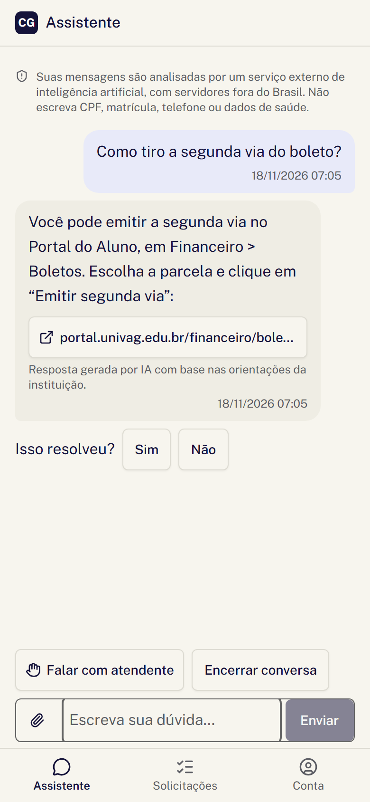
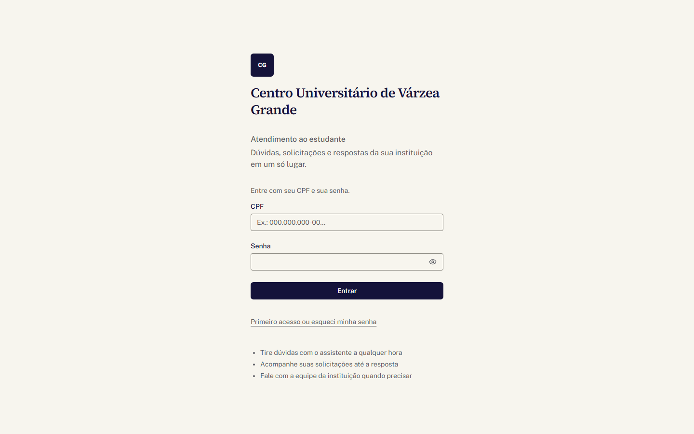
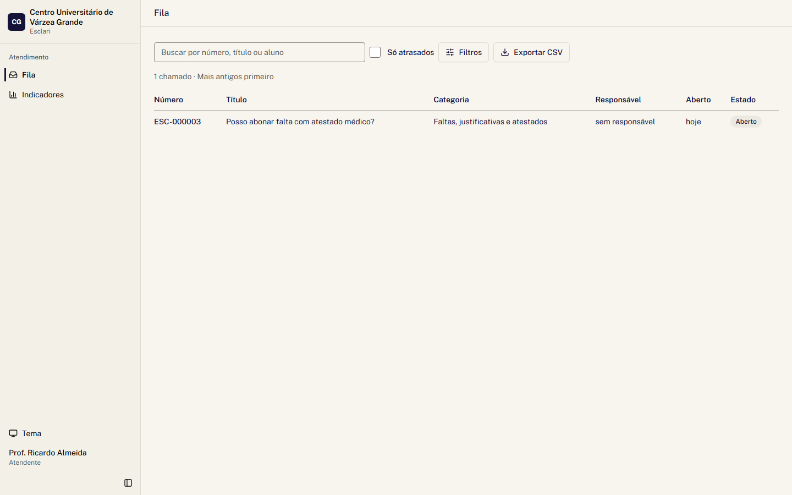
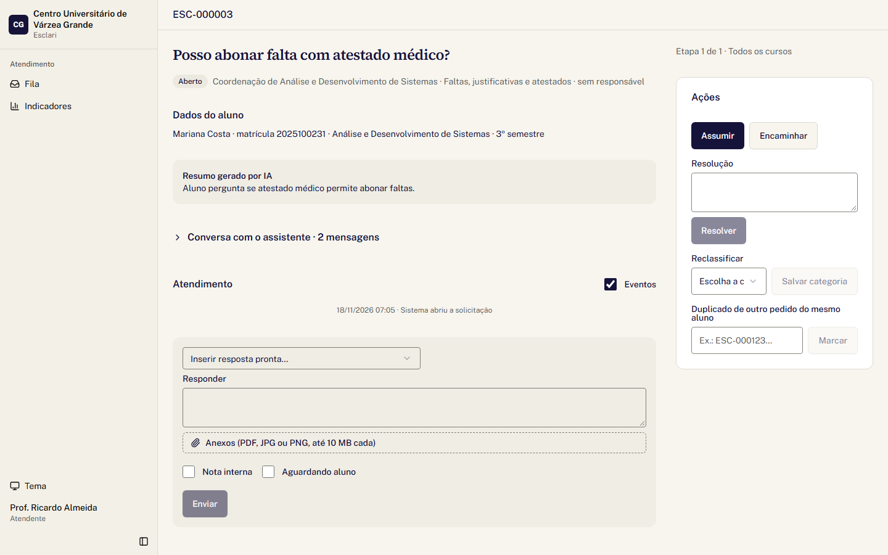
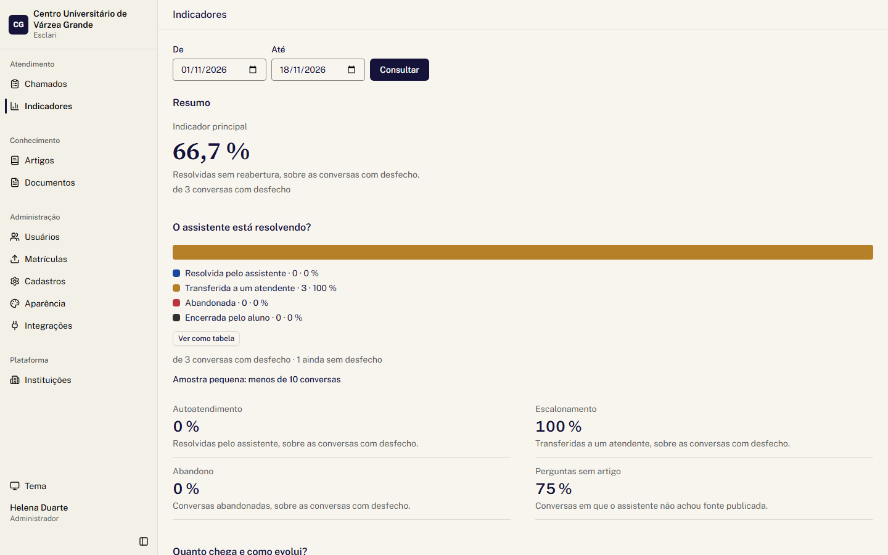
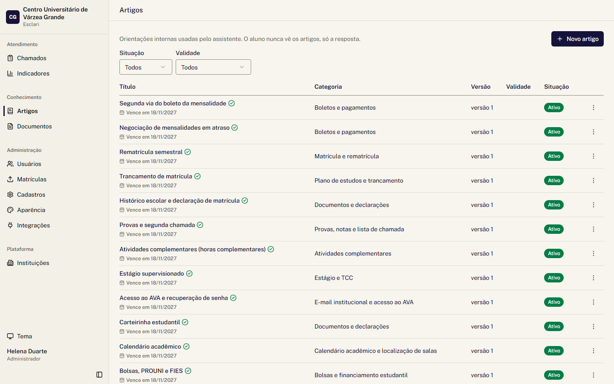
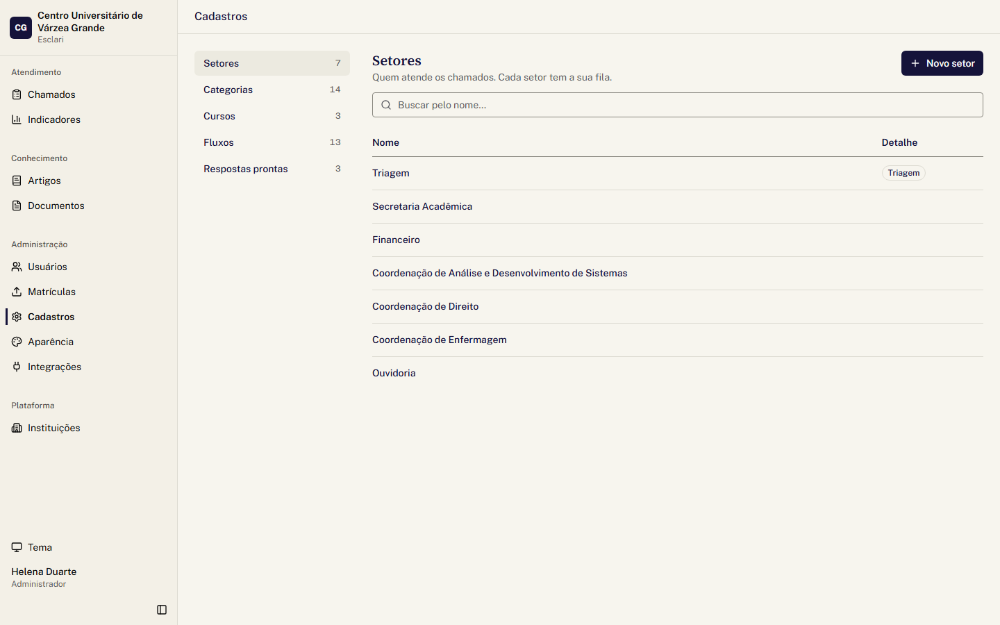

<div align="center">

# Esclari

**Helpdesk acadêmico multi-instituição: o aluno tira a dúvida com um assistente de IA que responde só com as fontes publicadas da instituição, e fala com um atendente quando quiser.**




</div>

## Sumário

- [Sobre o projeto](#sobre-o-projeto)
- [Telas](#telas)
- [Funcionalidades](#funcionalidades)
- [Tecnologias](#tecnologias)
- [Como rodar](#como-rodar)
- [Testes](#testes)
- [Estrutura do repositório](#estrutura-do-repositório)
- [Como trabalhamos](#como-trabalhamos)
- [Roadmap](#roadmap)
- [Licença](#licença)

## Sobre o projeto

O Esclari reúne em um lugar o atendimento ao estudante, no modelo de atendimento de banco:

1. O aluno entra com CPF e senha na página da sua instituição e conversa com o assistente.
2. O assistente busca nas orientações publicadas da instituição (RAG com `pgvector`) e só responde se a fonte confere. Quando não encontra, diz que não encontrou e oferece um atendente.
3. O aluno pode pedir um atendente a qualquer momento. O chamado chega ao setor certo com o protocolo `ESC-NNNNNN` e o contexto da conversa, sem o aluno repetir nada.
4. A equipe atende os chamados, mantém a base de conhecimento e acompanha os indicadores.

Várias instituições convivem no mesmo banco, isoladas por `instituicao_id` em toda tabela. A Univag é a primeira instituição.

## Telas

Capturas feitas com o Playwright sobre uma instituição fictícia (nomes, CPFs e matrículas inventados).

<table>
  <tr>
    <td width="50%"><br><sub><b>Login por instituição</b>, com a marca e os textos definidos pela própria instituição.</sub></td>
    <td width="50%"><br><sub><b>Fila</b> do atendente, com busca, filtros, filtro de atrasados e exportação em CSV.</sub></td>
  </tr>
  <tr>
    <td width="50%"><br><sub><b>Chamado</b> com o resumo da IA, a conversa com o assistente, ações por papel e respostas prontas.</sub></td>
    <td width="50%"><br><sub><b>Indicadores</b> organizados pelas perguntas do gestor: o assistente está resolvendo?</sub></td>
  </tr>
  <tr>
    <td width="50%"><br><sub><b>Base de conhecimento</b> com versões, validade de 12 meses e estado de cada artigo.</sub></td>
    <td width="50%"><br><sub><b>Cadastros</b> de setores, categorias, cursos, fluxos de atendimento e respostas prontas.</sub></td>
  </tr>
</table>

## Funcionalidades

**Aluno**
- Assistente com resposta conferida contra as fontes da instituição; anexos de fotos e PDFs na conversa.
- "Falar com atendente" a qualquer momento, com protocolo `ESC-NNNNNN` e previsão de resposta.
- Acompanhamento das solicitações, avisos por e-mail e por push com o app fechado.
- App instalável no celular (PWA), com barra de navegação inferior.

**Equipe**
- Fila, minhas solicitações e detalhe do chamado: assumir, responder, nota interna, aguardar aluno, resolver, encaminhar e reclassificar, com histórico imutável.
- Fluxos de atendimento configuráveis por categoria e abrangência, com simulador e editor visual.
- Prazos de primeira resposta e de resolução, com marca de atraso.
- Transformar a resposta de um chamado resolvido em rascunho de artigo.

**Gestão**
- Artigos e documentos (PDF) com versões, validade e renovação; indexação em segundo plano.
- Importação de matrículas por CSV, usuários, papéis e setores.
- Aparência por instituição (cor, logo, textos do login e do assistente).
- Indicadores, integração com o Moodle (LTI 1.3) e servidor MCP somente leitura.

## Tecnologias

| Camada | Tecnologia |
| --- | --- |
| API | .NET 10, ASP.NET Core minimal APIs, EF Core 10 + Npgsql, `Mediator` 3.x, SignalR |
| Dados | PostgreSQL 18 + `pgvector`, MinIO (anexos e PDFs), Mailpit (e-mail em desenvolvimento) |
| Web | React 19, Vite 8, TypeScript, Tailwind v4, shadcn/ui, TanStack Query, React Hook Form + Zod |
| IA | OpenAI (chat e `text-embedding-3-small`), com resposta conferida contra as fontes |
| Testes | xUnit v3 com `WebApplicationFactory`, Vitest + Testing Library, Playwright |

A API é organizada em fatias verticais por assunto (`Acesso`, `Administracao`, `Assistente`, `Chamados`, `Conhecimento`, `Indicadores`, `Instituicoes`), com um arquivo por caso de uso. As regras de arquitetura são testadas em `Esclari.Api.Tests/ArquiteturaTests.cs`.

## Como rodar

**Pré-requisitos:** .NET 10 SDK, Node 24, Docker.

```bash
git clone https://github.com/Bitforgee/Esclari.git
cd Esclari

# dependências: Postgres, Mailpit e MinIO
docker compose up -d postgres mailpit minio

# API em http://localhost:5226 (aplica as migrations na subida)
dotnet run --project Esclari.Api

# Web com proxy para a API
npm --prefix web ci
npm --prefix web run dev
```

Para a IA responder, informe a chave da OpenAI em `dotnet user-secrets` (`Llm:ChaveApi`) ou na variável `LLM_CHAVE_API` do `.env`. Sem a chave, o restante do sistema funciona e o assistente não responde. Nunca versione o `.env`.

**Primeira instituição.** Crie a instituição e o primeiro administrador pelo CLI da API:

```bash
dotnet run --project Esclari.Api -- instituicao criar \
  --slug demo --nome "Instituição Demo" --fuso America/Cuiaba \
  --admin-cpf <cpf> --admin-nome "Admin Demo" --admin-email admin@demo.exemplo
```

O link para criar a senha chega ao Mailpit em http://localhost:8025. Depois, acesse `http://localhost:5173/demo` (endereço do Vite).

**Tudo em contêineres:**

```bash
docker compose up -d --build   # app em http://localhost:8080
```

## Testes

| O quê | Comando |
| --- | --- |
| API | `dotnet test Esclari.Api.Tests` (usa o Postgres, o MinIO e o Mailpit do compose; cada classe cria o próprio banco) |
| Web | `npm --prefix web test` |
| Cobertura da web | `npm --prefix web run coverage` |
| E2E | `docker compose up -d --build`, `npm --prefix web run e2e:preparar` e `npm --prefix web run e2e` |

Os testes nunca chamam a IA real nem enviam e-mail de verdade: o relógio, o LLM e o push são falsos. O build quebra com complexidade ciclomática acima de 10 (CA1502).

## Estrutura do repositório

```text
Esclari.Api/          API .NET: fatias verticais por assunto e domínio em Dados/
Esclari.Api.Tests/    testes de integração e de domínio (xUnit v3)
web/                  React + Vite (PWA), uma pasta por fatia em src/
docs/imagens/         capturas de tela usadas neste README
.specs/               decisões (STATE.md), planos, checks e verificações por feature
ROADMAP.md            etapas, estado atual e riscos
AGENTS.md             instruções para agentes de IA e para quem contribui
```

## Como trabalhamos

O projeto segue desenvolvimento orientado por especificação: todo trabalho que muda comportamento passa por um plano aprovado por uma pessoa, por checks com prova (teste ou comando), pela construção e por uma verificação feita por quem não escreveu o código. As decisões ficam em [`.specs/STATE.md`](.specs/STATE.md) e cada feature tem a própria pasta em [`.specs/features/`](.specs/features/). Os detalhes e as convenções estão em [`AGENTS.md`](AGENTS.md).

Commits seguem Conventional Commits, em inglês (`feat(chamados): ...`), direto na `main`.

## Roadmap

Estado, etapas e riscos estão no [`ROADMAP.md`](ROADMAP.md). Em resumo: o código do MVP está pronto e verificado, e o que falta é a preparação para a banca e o piloto com a Univag (dados reais, hospedagem e ensaio de ponta a ponta).

## Licença

Ainda não há arquivo de licença no repositório. Até que os autores definam uma, todos os direitos permanecem reservados.
